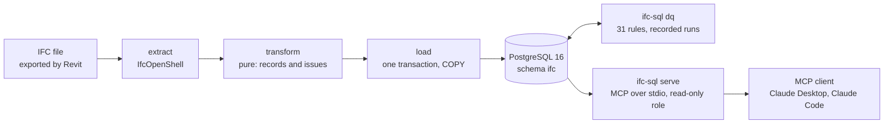

# ifc-sql-mcp

[](https://github.com/gewoonkees132/Ifc_Sql_Mcp/actions/workflows/ci.yml)

A data pipeline that loads building models exported from Autodesk Revit as IFC files into
a normalised PostgreSQL database, checks their data quality against a catalogue of
rules, and lets an LLM query them through an [MCP](https://modelcontextprotocol.io)
server, read-only.



Revit's IFC exports are valid but awkward: one building comes in three unit systems,
names pack family, type and element id into one string, quantities hide in parameters,
and unset values are placeholders that look like data. This project stores all of it
faithfully, says where it had to make a choice, measures the defects, and gives an LLM
tools that are correct by construction for the common questions and a guarded SQL
interface for the rest.

## Quick start

Requires [uv](https://docs.astral.sh/uv/) and Docker.

```bash
make install       # .venv from uv.lock, plus the pre-commit hooks
make up            # PostgreSQL 16 in Docker, bound to 127.0.0.1
make dq-samples    # download the four sample files, migrate, load and check them
make smoke         # start the MCP server as a client would and call a few tools
```

`make dq-samples` downloads the buildingSMART Duplex Apartment models (CC BY 4.0,
checksum-verified, not stored in this repository), then loads and checks them. On an
empty database:

```
loaded Duplex_A_20110907.ifc as model 1 (ARC): 295 objects, 13,455 property values, 0 issues (run 1)
loaded Duplex_MEP_20110907.ifc as model 2 (MEP): 973 objects, 63,683 property values, 46 issues (run 2)
loaded Duplex_Electrical_20121207.ifc as model 3 (ELE): 109 objects, 6,862 property values, 88 issues (run 3)
loaded Duplex_Plumbing_20121113.ifc as model 4 (PLU): 504 objects, 41,649 property values, 550 issues (run 4)
checked model 1 (ARC, Duplex_A_20110907.ifc) in dq run 1: 0 error, 7,650 warning, 473 info findings
checked model 2 (MEP, Duplex_MEP_20110907.ifc) in dq run 2: 0 error, 30,013 warning, 1,961 info findings
checked model 3 (ELE, Duplex_Electrical_20121207.ifc) in dq run 3: 0 error, 89 warning, 3,291 info findings
checked model 4 (PLU, Duplex_Plumbing_20121113.ifc) in dq run 4: 0 error, 1,471 warning, 13,223 info findings
```

Running it again loads nothing more: each file is identified by its SHA-256, and a
repeat is recorded as a skipped run (the check runs again, as a new recorded run).
`make smoke` then talks to the server over stdio:

```
connected to ifc-sql-mcp 0.1.0 over stdio (protocol 2026-07-28): 8 tools, 1 resource, 1 resource template, 1 prompt
list_models: 4 models
  model 1 ARC Duplex_A_20110907.ifc: elements 268, spaces 21; dq run 1: 0 error, 7,650 warning, 473 info
  model 2 MEP Duplex_MEP_20110907.ifc: elements 926, spaces 42; dq run 2: 0 error, 30,013 warning, 1,961 info
  …
```

To give Claude Code the server (the full instructions, also for Claude Desktop, are in
[docs/mcp.md](docs/mcp.md#registering-it-with-a-client)):

```bash
claude mcp add --env IFC_SQL_DATABASE_URL=postgresql+psycopg://localhost:5432/ifc \
  --env IFC_SQL_READER_PASSWORD=ifc-reader-dev-only \
  --transport stdio ifc-sql -- /path/to/uv run --directory /path/to/Ifc_Sql_Mcp ifc-sql serve
```

The passwords in this repository are public development defaults, safe only because
PostgreSQL listens on loopback. Anywhere else, set your own (`.env.example`,
[SECURITY.md](SECURITY.md)).

## What the sample files show

| File | Discipline | Unit declared | Elements | Spaces | Property values | Transform issues | Findings (warning / info) |
|---|---|---|---:|---:|---:|---:|---:|
| `Duplex_A_20110907.ifc` | ARC | m | 268 | 21 | 13,455 | 0 | 7,650 / 473 |
| `Duplex_MEP_20110907.ifc` | MEP | m | 926 | 42 | 63,683 | 46 | 30,013 / 1,961 |
| `Duplex_Electrical_20121207.ifc` | ELE | ft | 103 | 1 | 6,862 | 88 | 89 / 3,291 |
| `Duplex_Plumbing_20121113.ifc` | PLU | mm | 498 | 1 | 41,649 | 550 | 1,471 / 13,223 |

- **No errors.** The rules keep the error severity for something in the file that did
  not reach the database, such as a skipped object; none of the 58,171 findings is one.
- **Units are normalised.** The four files declare metres, feet and millimetres; every
  length, area and volume is stored in m, m² and m³, and Level 2 sits at 3.100 m in all
  four ([data-model.md](docs/data-model.md#storeys-across-disciplines)).
- **Placeholders dominate the findings.** Revit 2011 fills unset text parameters with
  their own name (`BarCode = 'BarCode'`): 29,967 of MEP's 31,974 findings. Revit 2013
  writes `'N/A'` instead.
- **Material totals are not element totals.** By element, the architectural model's
  area is 2,036.7 m²; by material it is 5,329.2 m², because a layered material covers the
  element's face once per layer. Plasterboard alone comes to 931.9 m², more than the
  587.7 m² of all the walls. The takeoff tool says which kind of total it reports.

The figures come from the commands above, and `make test-samples` pins them, so the
documentation cannot drift from the code.

## How it is built

Each part has a design record in [docs/adr/](docs/adr/README.md) with the alternatives
that were rejected.

- **Store** ([ADR 1](docs/adr/0001-postgresql.md)): PostgreSQL 16 through SQLAlchemy Core,
  psycopg 3 and Alembic. The database enforces the model: keys, foreign keys with
  cascades, CHECK constraints on formats and ranges (no blank identifiers, no NaN), and
  references checked at commit. Pending migrations run in one transaction, and tests
  compare the migrated database with `schema.py` and check every CHECK by name.
- **Data model** ([ADR 2](docs/adr/0002-properties-eav-vs-jsonb.md),
  [data-model.md](docs/data-model.md)): 14 tables and 7 views in schema `ifc`, every one
  commented. One `object` supertable for spatial elements and physical elements, so
  properties, quantities, classifications and findings all have real foreign keys. Property
  values are a typed entity-attribute-value table; quantities have a fixed vocabulary
  with their source and a precedence ([ADR 3](docs/adr/0003-quantity-sources-and-precedence.md));
  materials keep their layer order and thickness.
- **Ingest** ([ADR 4](docs/adr/0004-idempotent-ingest.md)): extract is the only module
  that touches IfcOpenShell; transform is pure and returns records that already satisfy
  every constraint; load writes one model in one transaction (COPY for the bulk tables,
  chosen by measurement). Every attempt is recorded, including failed and skipped ones; a
  concurrent ingest of the same file loses cleanly on the unique constraint. What the
  transform could not represent is stored as an issue with a stable code
  ([revit-ifc-quirks.md](docs/revit-ifc-quirks.md) goes through every quirk).
- **Data quality** ([ADR 5](docs/adr/0005-data-quality-rules.md),
  [data-quality.md](docs/data-quality.md)): 31 rules in one strictly loaded YAML catalogue,
  one per issue code plus five SQL rules for placeholders, empty values, elements without
  a storey and spaces without an area. Each run is recorded and evaluated set-based, so
  quality can be compared over time; a removed rule is retired, not deleted, while
  findings cite it.
- **MCP server** ([ADR 6](docs/adr/0006-mcp-server.md), [docs/mcp.md](docs/mcp.md)): seven
  fixed tools (models, storeys, element search and detail, takeoffs, room schedule, data
  quality report) handle the common questions with tested SQL, and `run_sql` the rest. The
  server connects only as a read-only role, opens a new session per call, and bounds every
  result. `run_sql` passes four layers, each tested on its own against PostgreSQL: a
  sqlglot validator with a function allowlist, a cursor that PostgreSQL accepts only for
  one SELECT, a read-only transaction with timeouts, and the role's privileges.

### Asking through MCP

The fixed tools answer most questions in one call. For the rest, `run_sql` takes one
read-only query, with [`ifc://schema`](docs/mcp.md#resources) as its map. Which walls of
the architectural model are external, by type:

```sql
SELECT e.revit_type, count(*) AS walls, round(sum(e.area_m2)::numeric, 1) AS area_m2
FROM v_element AS e JOIN property AS p ON p.object_id = e.object_id
WHERE e.model_id = 1 AND e.ifc_class_base = 'IfcWall'
  AND p.pset_name = 'Pset_WallCommon' AND p.prop_name = 'IsExternal' AND p.value_bool
GROUP BY e.revit_type ORDER BY area_m2 DESC
```

```json
[["Exterior - Brick on Block", 12, 272.0], ["Foundation - Concrete (417mm)", 4, 64.4],
 ["Party Wall - CMU Residential Unit Dimising Wall", 4, 61.9], ["Foundation - Concrete (435mm)", 3, 12.5]]
```

Anything else is refused before it reaches the database, with a reason the LLM can act
on: `DELETE FROM ifc.property` gets `query refused: only a query that reads data is
allowed (SELECT, WITH … SELECT, TABLE, UNION, INTERSECT, EXCEPT or VALUES); this is a
DELETE statement`.

## Quality

- **Tests**: 869 unit and integration tests, plus 102 on the four real files
  (`make test-samples`), with 100 % branch coverage. Integration tests run against real
  PostgreSQL in throwaway databases they create and migrate, never against the development
  database, and nothing in the safety layers is mocked. Races (two ingests of one file,
  two catalogue syncs at once) are staged with real blocked transactions.
- **Checks**: ruff (with the bandit rules and Google docstrings), mypy `--strict`, and
  pytest with warnings as errors, run by `make check` and by
  [CI](.github/workflows/ci.yml) on GitHub Actions with a PostgreSQL 16 service; ruff and
  mypy also run as pre-commit hooks.
- **Reproducible**: dependencies locked in `uv.lock`, CI actions pinned to commit SHAs,
  sample files pinned to an upstream commit and verified by SHA-256.

## Repository layout

```
src/ifc_sql_mcp/
  cli.py                 ifc-sql: migrate, ingest, dq, serve
  config.py              settings from IFC_SQL_* environment variables
  logging_config.py      key=value logs on stderr (stdout is the MCP protocol)
  db/                    schema.py, engines, migrations 0001-0009, versioned view SQL
  ingest/                extract (IfcOpenShell), transform (pure), load, pipeline
  dq/                    rule catalogue, sync, runs
  rules/dq_rules.yaml    the 31 data quality rules
  server/                MCP server: tools, run_sql, SQL validator, schema resource
tests/
  unit/                  no database needed
  integration/           real PostgreSQL, throwaway databases
  samples/               the four Duplex files (pytest -m sample)
  modern/                the audit's Revit 2019-2022 exports (pytest -m modern)
  fixtures/              a synthetic Revit-style IFC file and the script that writes it
scripts/                 sample download, quirks report, load benchmark, MCP smoke test
docs/                    data model, Revit quirks, data quality, MCP server, ADRs
```

## Documentation

| Document | Covers |
|---|---|
| [docs/data-model.md](docs/data-model.md) | The schema, its conventions, the views, loading, the read-only role, migrations |
| [docs/revit-ifc-quirks.md](docs/revit-ifc-quirks.md) | Each Revit export habit, how often it occurs in the samples, and what the pipeline does |
| [docs/data-quality.md](docs/data-quality.md) | The rule catalogue, severities, runs and the findings on the samples |
| [docs/mcp.md](docs/mcp.md) | Running the server, registering it with a client, every tool, resource and the prompt |
| [docs/adr/](docs/adr/README.md) | Six architecture decision records |
| [docs/audit/](docs/audit/2026-11-modern-revit-exports.md) | Audit on Revit 2021 and 2022 exports (IFC4, IFC2X3): an architect's workflow, what works and what does not, and a prioritised backlog |
| [docs/audit/2026-11-implementation.md](docs/audit/2026-11-implementation.md) | How the audit's backlog was implemented: per finding, the issue, the commits and the figures before and after |
| [SECURITY.md](SECURITY.md) | The threat model: LLM-written SQL, prompt injection through IFC content, credentials |

`make help` lists every target.

## Limitations

- Built and tested against Revit 2011 and 2013 exports in IFC2X3 (the four Duplex files
  and a synthetic fixture that reproduces their habits). Files from other exporters or in
  IFC4 are untested.
- Quantities come from the file; none is computed from geometry. The `geometry` source is
  reserved in the schema for that ([ADR 3](docs/adr/0003-quantity-sources-and-precedence.md)).
- A changed file is a new model version; versions are not diffed or merged, and old data
  quality runs are kept until deleted.
- The MCP server is for one local user: stdio only, no authentication
  ([SECURITY.md](SECURITY.md)).

## Licences

Code: [MIT](LICENSE). Sample data: buildingSMART International, CC BY 4.0, used
unmodified and downloaded on demand; see [DATA_ATTRIBUTION.md](DATA_ATTRIBUTION.md).
