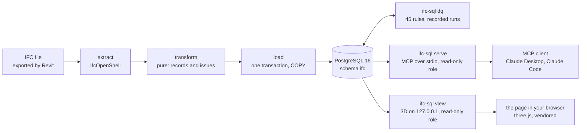
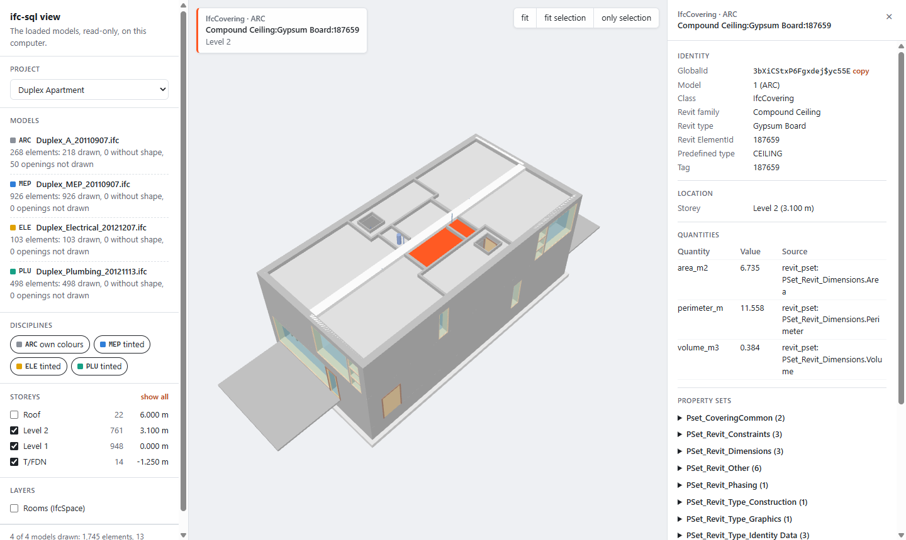

# ifc-sql-mcp

[](https://github.com/gewoonkees132/Ifc_Sql_Mcp/actions/workflows/ci.yml)

A data pipeline that loads building models exported from Autodesk Revit as IFC files into
a normalised PostgreSQL database, checks their data quality against a catalogue of
rules, and lets an LLM query them through an [MCP](https://modelcontextprotocol.io)
server, read-only. `ifc-sql view` shows the models in 3D in your browser.



Revit's IFC exports are valid but awkward: one building comes in three unit systems,
names pack family, type and element id into one string, quantities hide in parameters,
and unset values are placeholders that look like data. This project stores all of it
faithfully, says where it had to make a choice, measures the defects, and gives an LLM
tools that are correct by construction for the common questions and a guarded SQL
interface for the rest.

## Quick start

Requires [uv](https://docs.astral.sh/uv/), and Docker or nothing more: for one user,
`ifc-sql` can run PostgreSQL 16 itself in a folder (`IFC_SQL_DATA_DIR`, below). On
Windows, without `make`, follow [docs/windows.md](docs/windows.md). Before exporting from Revit, read
[docs/revit-export-settings.md](docs/revit-export-settings.md): which options the tool
reads, and what it does without them.

```bash
make install       # .venv from uv.lock, plus the pre-commit hooks
make up            # PostgreSQL 16 in Docker, bound to 127.0.0.1
make dq-samples    # download the four sample files, migrate, load and check them
make smoke         # start the MCP server as a client would and call a few tools
make view          # look at the four models in 3D in your browser (Ctrl+C stops it)
```

Without Docker, for one user, skip `make up`: with `IFC_SQL_DATA_DIR` set, the commands
start an embedded PostgreSQL 16 in that folder themselves, and stop it when the last one
exits ([ADR 13](docs/adr/0013-embedded-postgresql.md); it takes no passwords, so read
[SECURITY.md](SECURITY.md#the-embedded-database) first).

```bash
export IFC_SQL_DATA_DIR=~/.local/share/ifc-sql
make install dq-samples smoke view
```

`make dq-samples` downloads the buildingSMART Duplex Apartment models (CC BY 4.0,
checksum-verified, not stored in this repository), then loads and checks them. It loads
them with `ingest --viewer`, which also builds each model's 3D scene for the viewer
([ADR 14](docs/adr/0014-viewer.md)). On an empty database:

```
loaded Duplex_A_20110907.ifc as model 1 (ARC): 295 objects, 13,545 property values, 0 issues (run 1); scene built: 218 elements drawn, 0 without shape, 50 openings not drawn, 7 chunks, 0.5 MB
loaded Duplex_MEP_20110907.ifc as model 2 (MEP): 973 objects, 63,683 property values, 46 issues (run 2); scene built: 926 elements drawn, 0 without shape, 0 openings not drawn, 9 chunks, 4.7 MB
loaded Duplex_Electrical_20121207.ifc as model 3 (ELE): 109 objects, 6,862 property values, 88 issues (run 3); scene built: 103 elements drawn, 0 without shape, 0 openings not drawn, 4 chunks, 0.4 MB
loaded Duplex_Plumbing_20121113.ifc as model 4 (PLU): 504 objects, 41,649 property values, 550 issues (run 4); scene built: 498 elements drawn, 0 without shape, 0 openings not drawn, 4 chunks, 4.7 MB
checked model 1 (ARC, Duplex_A_20110907.ifc) in dq run 1: 0 error, 7,651 warning, 551 info findings (model content 0 / 7,651 / 551, loader coverage 0 / 0 / 0)
checked model 2 (MEP, Duplex_MEP_20110907.ifc) in dq run 2: 0 error, 30,035 warning, 1,961 info findings (model content 0 / 30,035 / 1,961, loader coverage 0 / 0 / 0)
checked model 3 (ELE, Duplex_Electrical_20121207.ifc) in dq run 3: 0 error, 90 warning, 3,291 info findings (model content 0 / 90 / 3,291, loader coverage 0 / 0 / 0)
checked model 4 (PLU, Duplex_Plumbing_20121113.ifc) in dq run 4: 0 error, 1,472 warning, 13,223 info findings (model content 0 / 1,472 / 13,223, loader coverage 0 / 0 / 0)
```

A scene's three counts add up to the model's elements: the Duplex ARC model's 268 are 218
drawn (two stairs and a roof among them, drawn through their parts), none without a shape,
and 50 openings, which IfcOpenShell cuts out of their walls. The bytes may differ a little
on another platform. Running it again loads nothing more: each file is identified by its
SHA-256, a repeat is recorded as a skipped run, and a scene that is current is kept (the
check runs again, as a new recorded run).
`make smoke` then talks to the server over stdio:

```
connected to ifc-sql-mcp 0.1.0 over stdio (protocol 2026-07-28): 11 tools, 1 resource, 1 resource template, 1 prompt
list_models: 4 models
  model 1 ARC Duplex_A_20110907.ifc: elements 268, spaces 21; dq run 1: 0 error, 7,651 warning, 551 info
  model 2 MEP Duplex_MEP_20110907.ifc: elements 926, spaces 42; dq run 2: 0 error, 30,035 warning, 1,961 info
  …
```

`make view` (`uv run ifc-sql view`) then shows the four disciplines together in your
browser, storey by storey, with an element's properties on a click
([docs/viewer.md](docs/viewer.md)). It listens on 127.0.0.1 only, and the address it
prints carries a token, new on every start, that the page needs:



`make demo` (`uv run python scripts/demo.py`) loads the Duplex, checks it, and asks nine
questions through the MCP server with no LLM, lighting each answer in the page
([docs/viewer.md](docs/viewer.md#the-scripted-demo)). `make demo-audit` (`scripts/demo.py
--script audit`) does the same with four questions on the audit's Revit exports, which
stay local. With `IFC_SQL_VIEWER_FEED=1`, the server your own client starts does the same
for every call, and the page shows the calls of every client on the database
([docs/mcp.md](docs/mcp.md#with-the-viewers-feed-on)).

To give Claude Code the server (the full instructions, also for Claude Desktop, are in
[docs/mcp.md](docs/mcp.md#registering-it-with-a-client)):

```bash
claude mcp add --env IFC_SQL_DATABASE_URL=postgresql+psycopg://localhost:5432/ifc \
  --env IFC_SQL_READER_PASSWORD=ifc-reader-dev-only \
  --transport stdio ifc-sql -- /path/to/uv run --directory /path/to/Ifc_Sql_Mcp ifc-sql serve
```

The passwords in this repository are public development defaults, safe only because
PostgreSQL listens on loopback. Anywhere else, set your own (`.env.example`,
[SECURITY.md](SECURITY.md)).

**After pulling a new version**, run `ifc-sql migrate` (`make migrate`): `ifc-sql serve`
refuses a database at an older revision and says so. Migration 0020 adds the viewer's
schema, `ifc_viewer`; a model loaded before it gets its scene from
`ifc-sql ingest <file> --discipline … --viewer`, which builds it in place.

## What the sample files show

| File | Discipline | Unit declared | Elements | Spaces | Property values | Transform issues | Findings (warning / info) |
|---|---|---|---:|---:|---:|---:|---:|
| `Duplex_A_20110907.ifc` | ARC | m | 268 | 21 | 13,545 | 0 | 7,651 / 551 |
| `Duplex_MEP_20110907.ifc` | MEP | m | 926 | 42 | 63,683 | 46 | 30,035 / 1,961 |
| `Duplex_Electrical_20121207.ifc` | ELE | ft | 103 | 1 | 6,862 | 88 | 90 / 3,291 |
| `Duplex_Plumbing_20121113.ifc` | PLU | mm | 498 | 1 | 41,649 | 550 | 1,472 / 13,223 |

- **No errors.** The rules keep the error severity for something in the file that did
  not reach the database, such as a skipped object; none of the 58,274 findings is one, and none is a gap in the loader's coverage.
- **Units are normalised.** The four files declare metres, feet and millimetres; every
  length, area and volume is stored in m, m² and m³, and Level 2 sits at 3.100 m in all
  four ([data-model.md](docs/data-model.md#storeys-across-disciplines)).
- **Placeholders dominate the findings.** Revit 2011 fills unset text parameters with
  their own name (`BarCode = 'BarCode'`): 29,967 of MEP's 31,975 findings. Revit 2013
  writes `'N/A'` instead.
- **Material totals are not element totals.** By element, the architectural model's
  area is 1,505.0 m²; by material it is 4,797.5 m², because a layered material covers the
  element's face once per layer. Plasterboard alone comes to 931.9 m², more than the
  587.7 m² of all the walls. The takeoff tool says which kind of total it reports.

The figures come from the commands above, and `make test-samples` pins them, so the
documentation cannot drift from the code.

## How it is built

Each part has a design record in [docs/adr/](docs/adr/README.md) with the alternatives
that were rejected.

- **Store** ([ADR 1](docs/adr/0001-postgresql.md)): PostgreSQL 16 through SQLAlchemy Core,
  psycopg 3 and Alembic. The database enforces the model: keys, foreign keys with
  cascades, CHECK constraints on formats and ranges (no blank identifiers, no NaN), and
  references checked at commit. Pending migrations run in one transaction, and tests
  compare the migrated database with `schema.py` and check every CHECK by name.
- **Data model** ([ADR 2](docs/adr/0002-properties-eav-vs-jsonb.md),
  [data-model.md](docs/data-model.md)): 14 tables and 8 views in schema `ifc`, every one
  commented. One `object` supertable for spatial elements and physical elements, so
  properties, quantities, classifications and findings all have real foreign keys. Property
  values are a typed entity-attribute-value table; quantities have a fixed vocabulary
  with their source and a precedence ([ADR 3](docs/adr/0003-quantity-sources-and-precedence.md));
  materials keep their layer order and thickness.
- **Ingest** ([ADR 4](docs/adr/0004-idempotent-ingest.md)): extract is the only module
  that touches IfcOpenShell; transform is pure and returns records that already satisfy
  every constraint; load writes one model in one transaction (COPY for the bulk tables,
  chosen by measurement). Every attempt is recorded, including failed and skipped ones; a
  concurrent ingest of the same file loses cleanly on the unique constraint. What the
  transform could not represent is stored as an issue with a stable code
  ([revit-ifc-quirks.md](docs/revit-ifc-quirks.md) goes through every quirk).
- **Data quality** ([ADR 5](docs/adr/0005-data-quality-rules.md),
  [data-quality.md](docs/data-quality.md)): 45 rules in one strictly loaded YAML catalogue,
  one per issue code plus sixteen SQL rules: placeholders, empty values, elements without
  a storey, quantities that disagree, and handover requirements (quantities, rooms, fire
  ratings, real materials, project information). Each rule's scope says whether a
  finding is the model's gap or the loader's. Each run is recorded and evaluated set-based, so
  quality can be compared over time; a removed rule is retired, not deleted, while
  findings cite it.
- **MCP server** ([ADR 6](docs/adr/0006-mcp-server.md),
  [ADR 9](docs/adr/0009-schema-discovery-tool.md), [docs/mcp.md](docs/mcp.md)): nine
  fixed tools (models, storeys, element search and detail, takeoffs, schedules, room
  schedule, data quality report, comparison of two exports) handle the common questions
  with tested SQL, and `run_sql` the rest, with `describe_schema` as its map and errors
  that name the tables and columns that exist. The server connects only as a read-only
  role, opens a new session per call, and bounds every result. `run_sql` passes four
  layers, each tested on its own against PostgreSQL: a sqlglot validator with a function
  allowlist, a cursor that PostgreSQL accepts only for one SELECT, a read-only
  transaction with timeouts, and the role's privileges.
- **Viewer** ([ADR 14](docs/adr/0014-viewer.md), [docs/viewer.md](docs/viewer.md)):
  `ingest --viewer` triangulates every element and space with IfcOpenShell and stores
  the scene as glTF chunks per storey in schema `ifc_viewer`. `ifc-sql view` serves them
  on 127.0.0.1 to a page of plain ES modules with three.js, which draws each chunk as two
  BatchedMeshes: file B's 11,297 elements in 76 draw calls. The port answers only its own
  Host, every data route needs the start's token, and the page sets IFC text only as text.
  With `IFC_SQL_VIEWER_FEED=1`, `serve` publishes each call as a PostgreSQL notification;
  `view` checks every one as untrusted, and lights what the call found with the tools'
  own SQL. `ifc-sql demo` plays nine questions on the Duplex through the real server, and
  CI checks each answer on Linux and Windows; `--script audit` plays four on the audit's
  exports, which the `modern` tests check.

### Asking through MCP

The fixed tools answer most questions in one call. For the rest, `run_sql` takes one
read-only query, with [`describe_schema`](docs/mcp.md#describe_schema) as its map. Which walls of
the architectural model are external, by type:

```sql
SELECT e.revit_type, count(*) AS walls, round(sum(e.area_m2)::numeric, 1) AS area_m2
FROM v_element AS e JOIN property AS p ON p.object_id = e.object_id
WHERE e.model_id = 1 AND e.ifc_class_base = 'IfcWall'
  AND p.pset_name = 'Pset_WallCommon' AND p.prop_name = 'IsExternal' AND p.value_bool
GROUP BY e.revit_type ORDER BY area_m2 DESC
```

```json
[["Exterior - Brick on Block", 12, 272.0], ["Foundation - Concrete (417mm)", 4, 64.4],
 ["Party Wall - CMU Residential Unit Dimising Wall", 4, 61.9], ["Foundation - Concrete (435mm)", 3, 12.5]]
```

Anything else is refused before it reaches the database, with a reason the LLM can act
on: `DELETE FROM ifc.property` gets `query refused: only a query that reads data is
allowed (SELECT, WITH … SELECT, TABLE, UNION, INTERSECT, EXCEPT or VALUES); this is a
DELETE statement`.

## Quality

- **Tests**: 1,650 unit and integration tests at 100 % branch coverage, plus 155 on the
  real files: the four Duplex models (`make test-samples`) and the audit's five Revit
  2019–2022 exports, whose acceptance tests pin every audit and re-check finding
  (`make test-modern`, [docs/audit/](docs/audit/2026-11-implementation.md)). Integration tests run against real
  PostgreSQL in throwaway databases they create and migrate, never against the development
  database, and nothing in the safety layers is mocked. Races (two ingests of one file,
  two catalogue syncs at once) are staged with real blocked transactions.
- **Checks**: ruff (with the bandit rules and Google docstrings), mypy `--strict`, and
  pytest with warnings as errors, run by `make check` and by
  [CI](.github/workflows/ci.yml) on GitHub Actions with a PostgreSQL 16 service. A
  Windows job runs [the Windows quick start](docs/windows.md) on the embedded database on
  every push, and fetches a chunk of a scene from `ifc-sql view` there. ruff and mypy
  also run as pre-commit hooks.
- **Reproducible**: dependencies locked in `uv.lock`, CI actions pinned to commit SHAs,
  sample files pinned to an upstream commit and verified by SHA-256.

## Repository layout

```
src/ifc_sql_mcp/
  cli.py                 ifc-sql: migrate, ingest, dq, watch, serve, view
  config.py              settings from IFC_SQL_* environment variables
  logging_config.py      key=value logs on stderr (stdout is the MCP protocol)
  watch.py               ifc-sql watch: load and check each export saved to a folder
  db/                    schema.py, engines, embedded PostgreSQL, migrations 0001-0020, view SQL
  ingest/                extract (IfcOpenShell), transform (pure), load, pipeline
  viewer/                3D scenes (ingest --viewer) and ifc-sql view: its app, its port's
                         checks, the feed of MCP calls and what they light, the scripted
                         demo, and the page in static/, three.js vendored
  dq/                    rule catalogue, sync, runs
  rules/dq_rules.yaml    the 45 data quality rules
  server/                MCP server: tools, run_sql, SQL validator, schema description
tests/
  unit/                  no database needed
  integration/           real PostgreSQL, throwaway databases
  samples/               the four Duplex files (pytest -m sample)
  modern/                the audit's Revit 2019-2022 exports (pytest -m modern)
  fixtures/              a synthetic Revit-style IFC file and the script that writes it
  support/               helpers the suites share: sample files, an MCP client, builders
scripts/                 sample downloads, the demo, quirks report, load benchmark, MCP and view smoke tests
docs/                    data model, Revit quirks, data quality, MCP server, ADRs, audit
```

## Documentation

| Document | Covers |
|---|---|
| [docs/data-model.md](docs/data-model.md) | The schema, its conventions, the views, loading, the read-only role, migrations |
| [docs/revit-ifc-quirks.md](docs/revit-ifc-quirks.md) | Each Revit export habit, how often it occurs in the samples, and what the pipeline does |
| [docs/data-quality.md](docs/data-quality.md) | The rule catalogue, severities, runs and the findings on the samples |
| [docs/mcp.md](docs/mcp.md) | Running the server, registering it with a client, every tool, resource and the prompt |
| [docs/viewer.md](docs/viewer.md) | `ifc-sql view` and `ifc-sql demo`: starting them, what the page shows, the scripted demo, the feed of MCP calls and what each lights, the event, the routes, the frames per second on file B, and upgrading three.js |
| [docs/revit-export-settings.md](docs/revit-export-settings.md) | The Revit export options the tool reads, the habits that keep answers right, and `--geometry` for files without quantities |
| [docs/windows.md](docs/windows.md) | The quick start in PowerShell, without `make` and without Docker (the embedded database), including `ifc-sql watch` on an export folder and `ifc-sql view`; CI runs it on Windows |
| [docs/adr/](docs/adr/README.md) | Fourteen architecture decision records |
| [docs/audit/](docs/audit/2026-11-modern-revit-exports.md) | Audit on Revit 2021 and 2022 exports (IFC4, IFC2X3): an architect's workflow, what works and what does not, and a prioritised backlog |
| [docs/audit/2026-11-recheck.md](docs/audit/2026-11-recheck.md) | The audit's workflow repeated on the fixed tool, and the four findings it made (R1–R4) |
| [docs/audit/2026-11-implementation.md](docs/audit/2026-11-implementation.md) | How the audit's backlog and the re-check's findings were implemented: per finding, the issue, the commits and the figures before and after |
| [SECURITY.md](SECURITY.md) | The threat model: LLM-written SQL, prompt injection through IFC content, credentials, the viewer's port and its feed |

`make help` lists every target.

## Limitations

- Built and tested against Revit exports: 2011 and 2013 in IFC2X3 (the four Duplex
  files), and 2019, 2021 and 2022 in IFC2X3 and IFC4 (the audit's five files,
  `make test-modern`). Files from other exporters are untested.
- Quantities come from the file: IFC base quantities first, then Revit's parameters
  and a door's or window's size ([ADR 3](docs/adr/0003-quantity-sources-and-precedence.md),
  [ADR 8](docs/adr/0008-ifc-base-quantities.md)). A value that breaks a physical bound
  of its set is flagged and not used ([ADR 7](docs/adr/0007-quantity-set-plausibility.md)).
  A file exported without quantities can be measured instead, with
  `ifc-sql ingest --geometry` ([ADR 10](docs/adr/0010-geometry-quantities.md)): about a
  minute for 15,000 objects on 4 cores, and only for walls, slabs, spaces and other
  solids. A file already loaded is measured into the same model
  ([ADR 12](docs/adr/0012-measure-in-place.md)).
- A changed file is a new model version. `--replaces` marks the current one, and
  `compare_models` lists what changed between two; versions are not merged, and old data
  quality runs are kept until deleted.
- The MCP server is for one local user: stdio only, no authentication. `ifc-sql view`
  listens on 127.0.0.1 only, behind a token ([SECURITY.md](SECURITY.md)).
- The viewer's feed reaches every login to the database, which can also send to it; it is
  off unless `IFC_SQL_VIEWER_FEED=1` ([SECURITY.md](SECURITY.md#the-viewers-feed-ifc_sql_viewer_feed)).
  The demo on GitHub Pages is the next phase of
  [the viewer's plan](docs/plans/2026-11-ifc-viewer.md).

## Licences

Code: [MIT](LICENSE). [three.js](https://threejs.org) r187, vendored in
`src/ifc_sql_mcp/viewer/static/vendor/three/` for the viewer's page: MIT, its
[licence](src/ifc_sql_mcp/viewer/static/vendor/three/LICENSE) beside it. Sample data: buildingSMART International, CC BY 4.0, used
unmodified and downloaded on demand; see [DATA_ATTRIBUTION.md](DATA_ATTRIBUTION.md).
