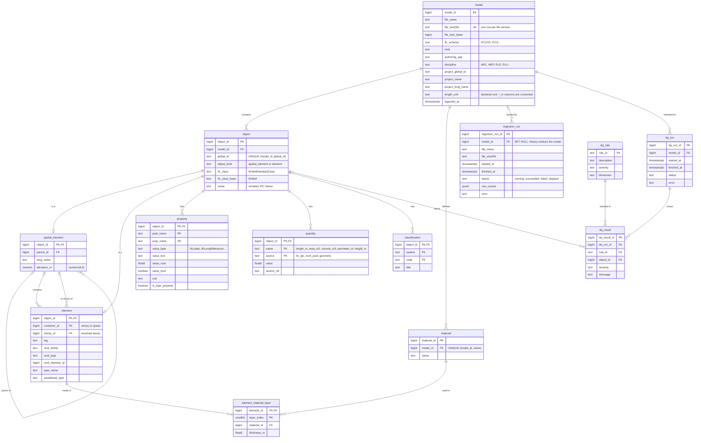

# Data model

Everything lives in one PostgreSQL schema, `ifc`: 13 tables, 5 views and a read-only
role. It is created by Alembic migrations:

```bash
make up        # PostgreSQL 16 in Docker
make migrate   # or: uv run ifc-sql migrate
```

The table definitions live in
[`src/ifc_sql_mcp/db/schema.py`](../src/ifc_sql_mcp/db/schema.py) (SQLAlchemy Core),
the views in [`src/ifc_sql_mcp/db/sql/views/`](../src/ifc_sql_mcp/db/sql/views/), and
the migrations in
[`src/ifc_sql_mcp/db/migrations/versions/`](../src/ifc_sql_mcp/db/migrations/versions/).
Every table, view and column carries a `COMMENT`. The MCP `ifc://schema` resource is
generated from those comments, so the catalogue documents itself
(`\d+ ifc.element` in psql shows them).

Two decisions shape most of the model. [ADR 1](adr/0001-postgresql.md) covers why
PostgreSQL, and [ADR 2](adr/0002-properties-eav-vs-jsonb.md) covers how properties are
stored and why everything hangs off one `object` table.

## Entity-relationship diagram



## Tables

| Table | Grain | Notes |
|---|---|---|
| `model` | one IFC file version | Identified by `file_sha256`, so loading the same bytes twice is impossible. `discipline` is supplied at ingest; IFC files do not state it. |
| `ingestion_run` | one ingest attempt | Written outside the load transaction, so failed and skipped runs are recorded too. Keeps `file_sha256` because `model_id` is NULL when no model was committed. |
| `object` | one IFC product | Shared supertype of spatial elements and physical elements (class-table inheritance, ADR 2). |
| `spatial_element` | site, building, storey, space | `parent_id` follows `IfcRelAggregates`. |
| `element` | wall, door, duct, chair... | `container_id` is the direct `IfcRelContainedInSpatialStructure` target; `storey_id` is resolved at ingest. |
| `property` | one value per object, set and name | Typed entity-attribute-value table (ADR 2). |
| `quantity` | one value per object, quantity and source | Canonical names whose suffix is the unit. Several sources can coexist. |
| `material` | one material name per model | IFC materials have no GlobalId, so the name is the key within a file. |
| `element_material_layer` | one layer (or list entry) per element | Ordered by `layer_index`. A single `IfcMaterial` is one row without thickness. |
| `classification` | one code per object and system | From `IfcClassificationReference` or from Revit parameters such as OmniClass. |
| `dq_rule`, `dq_run`, `dq_result` | rule catalogue, one evaluation, one finding | Results are kept per run so quality can be compared over time. `dq_result.severity` records the severity at run time. |

### How the Revit quirks map onto the schema

[revit-ifc-quirks.md](revit-ifc-quirks.md) shows how often each quirk occurs in the four
Duplex files and how the extract and transform stages handle it.

| Quirk in Revit exports | Where the schema handles it |
|---|---|
| No `Qto_*` base quantities; quantities sit in `PSet_Revit_Dimensions` | `quantity.source` (`revit_pset`), alongside `ifc_qto` and `geometry` rows for the same object. The raw values also stay in `property`. |
| Names follow `Family:Type:ElementId`; loadable families add an instance label (`Family:Type:Label:ElementId`), and openings and stair parts add a `:n` suffix to their host's name | `object.name` keeps the raw string. `element.revit_family`, `revit_type` and `revit_element_id` hold the parsed parts. `revit_element_id` is indexed but deliberately not unique. |
| Walls have no `IfcTypeObject`; type data arrives as `PSet_Revit_Type_*` on the instance | `property.is_type_property`, set for those sets and for values inherited from a type object. |
| Placeholder values (`Manufacturer = 'Manufacturer'`), empty strings | Stored verbatim in `property.value_text` so data-quality rules can find them; nothing rejects them. |
| Layered walls (`IfcMaterialLayerSetUsage`) | `element_material_layer` keeps layer order and thickness; `v_takeoff` splits area and volume per layer. |
| OmniClass Table 13 as a parameter value | Stored as a `classification` row (system `OmniClass Table 13`), and read by `v_space_schedule`. |
| `IfcWallStandardCase` versus `IfcWall` | `object.ifc_class` keeps the exact entity; `ifc_class_base` holds the normalised one for filtering. |
| Storey elevations with float noise (`3.100000000000378`) | `spatial_element.elevation_m` is `numeric(9,3)`. The column itself rounds to the millimetre, so storeys compare equal across models. |

Looking at the four pinned Duplex files turned up a few more facts that the schema
accommodates:

- **Units differ by file.** The files declare metres, millimetres and feet, so every
  `*_m` column is converted at ingest and `model.length_unit` records what the file
  declared.
- **Furniture sits in rooms.** The architectural model contains its furniture in
  spaces, not storeys, hence `container_id` plus a resolved `storey_id`.
- **Material lists exist.** The electrical and plumbing files use `IfcMaterialList`
  and single `IfcMaterial`, so `thickness_m` is nullable.
- **Classifications appear two ways.** The electrical and plumbing files carry
  UniFormat `IfcClassificationReference`s, while OmniClass arrives as a Revit
  parameter.
- **Project GlobalIds don't match.** The architectural model's `IfcProject` GlobalId
  differs from the other three files, so `project_global_id` is stored but cannot
  match models; Phase 4 matches across disciplines by name.
- **Quantity sets coexist with Revit parameters.** Spaces carry a `GSA Space Areas`
  quantity set (an `IfcElementQuantity`) next to the Revit `Area` parameter, which is
  why a quantity can have more than one source.

## Conventions

- **Keys.** Entity tables (`model`, `object`, `material`, runs, results) have a
  `bigint GENERATED ALWAYS AS IDENTITY` key named `<table>_id`. Dependent attribute
  tables (`property`, `quantity`, `classification`, `element_material_layer`) use their
  natural composite key, because nothing references their rows individually. Foreign
  key columns are named after the key they reference, or after their role (`parent_id`,
  `storey_id`, `container_id`).
- **Constraint names** follow one convention (`pk_`, `fk_`, `uq_`, `ix_`, `ck_<table>_…`).
  This lets tests assert that the intended constraint rejected a row.
- **Units** are SI and named in the column (`elevation_m`, `thickness_m`) or in the
  quantity name (`area_m2`).
- **NULL means absent.** Identifier-like text columns reject blank strings
  (`CHECK (col ~ '\S')`). Property values are the exception: they keep what the file says.
- **Finite numbers.** `float8` accepts `NaN` and `±Infinity`, and `NaN` would poison
  `SUM()`. Float columns therefore carry `CHECK (x > '-Infinity' AND x < 'Infinity')`, or
  `x >= 0 AND x < 'Infinity'` for quantities and thicknesses. PostgreSQL sorts `NaN` above
  every other value, so the upper bound rejects it too.
- **Deletes cascade from `model`.** One `DELETE FROM ifc.model WHERE model_id = …`
  removes everything loaded from a file. Run history survives: `ingestion_run.model_id`
  becomes NULL.
- **Sideways references are checked at commit.** These are `parent_id`, `container_id`,
  `storey_id` and `element_material_layer.material_id`, which point between rows of the
  same model. PostgreSQL runs each cascade step as a separate internal statement, so an
  immediate check can see a half-deleted model and fail. These four foreign keys are
  therefore `DEFERRABLE INITIALLY DEFERRED`. A storey or material that is still in use
  cannot be deleted on its own (the commit fails), but a whole model can.
  `test_deleting_a_model_removes_everything_loaded_from_it` failed before this change.
- **What the database does not enforce** is left to the loader, which writes one model
  in one transaction:
  - an object has exactly one subtype row, matching `object_kind`;
  - `storey_id` points at a storey;
  - every row of an element's graph belongs to the same model.

  Each of these would need triggers or composite keys, which is more machinery than the
  risk warrants.

## Views

Each view is a versioned file (`v_element.v1.sql`) that also carries its `COMMENT`s.

| View | One row per | What it adds |
|---|---|---|
| `v_quantity` | object and quantity | Picks one value when several sources supply it, in the order `ifc_qto`, then `revit_pset`, then `geometry`: an IFC quantity set written by the exporter, then Revit's own parameter, then a value computed here. The other views read quantities through it. |
| `v_element` | element | Identity, Revit name parts, storey and elevation, the containing room, the five canonical quantities as columns, and materials in layer order (`Plasterboard / Metal - Stud Layer / Plasterboard`). |
| `v_space_schedule` | space | Number, name, storey, area, perimeter, volume, height and the OmniClass Table 13 code and title. |
| `v_takeoff` | model × storey × `ifc_class_base` × material | Element count and summed length, area and volume. A layered material covers the element's face once per layer, so its area is element area × layer count and its volume is element area × total thickness. Plasterboard on both faces of a 10 m² wall is 20 m² and 0.32 m³. Materials without layers take the element's own quantities. |
| `v_model_summary` | model | File and project metadata, row counts, and the findings of the latest successful data-quality run. The finding counts are NULL, not 0, for a model never checked. |

`tests/integration/test_views.py` builds a small building that reproduces these cases
and checks each figure.

## The read-only role

`ifc_reader` is the role the MCP server's `run_sql` tool will use. Migration 0003
creates it with these layers:

1. **Privileges, the actual boundary:** `USAGE` on schema `ifc` and `SELECT` on its
   tables and views, nothing else. `ALTER DEFAULT PRIVILEGES` extends the grant to tables
   and views that later migrations create. `REVOKE CREATE ON SCHEMA public FROM PUBLIC`
   repeats the PostgreSQL 15+ default for databases initialised by older versions.
2. **Session defaults, guard rails on top:** per database (`ALTER ROLE … IN DATABASE`),
   `default_transaction_read_only = on`, `statement_timeout = 5s`,
   `idle_in_transaction_session_timeout = 30s`, and `search_path = ifc`, so an LLM can
   write `FROM v_element`. A client can override these with `SET`, which is why the
   tests check the privilege boundary inside an explicitly read-write transaction.
3. **Role attributes:** `LOGIN`, `CONNECTION LIMIT 20`, and none of `SUPERUSER`,
   `CREATEDB`, `CREATEROLE`, `REPLICATION` or `BYPASSRLS`. If a role of that name already
   exists with any of those, or is a member of another role, the migration refuses to
   continue rather than calling it read-only.

Phase 6 adds the connection-level settings and `sqlglot` query validation on top.

**Password.** The password comes from `IFC_SQL_READER_PASSWORD`. Its dev-only default
is `ifc-reader-dev-only`, the same kind of public default as the development database
URL. The migration hashes it on the client into the SCRAM verifier PostgreSQL stores,
the same way `psql`'s `\password` works. The plaintext never reaches the server, so it
cannot appear in server logs even with `log_statement = 'all'`. Clients build their URL
with `reader_database_url()`, which keeps host, port and database from
`IFC_SQL_DATABASE_URL`. To rotate the password, run `ALTER ROLE ifc_reader PASSWORD …`
(or `\password ifc_reader`) as the owner and update the variable. Migrations set it
only when 0003 runs.

**Roles are cluster-wide; databases are not.** The development database and the
throwaway test databases share one server, and therefore one `ifc_reader`. So:

- **Upgrade** creates the role only if it is missing. It catches `duplicate_object`
  instead of checking first, which also covers two databases being migrated at the same
  moment. It then reapplies the login settings, password and this database's grants.
  Running it in a second database is harmless.
- **Downgrade** revokes everything this database granted, resets this database's role
  settings and keeps the role. Another database on the cluster may still rely on it,
  and PostgreSQL would refuse to drop a role that holds privileges elsewhere. On a
  cluster with no such database, `DROP ROLE ifc_reader` afterwards removes it;
  `make reset-db` removes it with everything else.

## Migrations

- **One transaction.** All pending migrations run in a single transaction (PostgreSQL
  DDL is transactional), so a failed upgrade changes nothing.
- **Frozen once released.** A migration never imports `schema.py`. A view file, once a
  migration uses it, is never edited: a changed view becomes `v_element.v2.sql` plus a
  new migration that drops `v1` and creates `v2`, and its downgrade restores `v1`. An old
  migration therefore always produces the same objects.
- **Configured in code.** The database URL always comes from `IFC_SQL_DATABASE_URL`;
  there is no `alembic.ini` with credentials in it. `ifc-sql migrate` builds the
  Alembic configuration in code, so an installed wheel can migrate a database.
  `[tool.alembic]` in `pyproject.toml` lets the plain CLI work for development
  (`uv run alembic history`).
- **`search_path` is pinned to `public`** on migration connections. The default path
  starts with `"$user"`, and the development role is called `ifc`, like the schema.
  Without the pin, Alembic's version table could land inside `ifc`, and an autogenerate
  comparison would skip `ifc` as "the default schema".
- **Offline (`--sql`) mode is refused,** because migration 0003 needs a live connection
  to hash the password.

**Writing a new migration.** Change `schema.py`, then run
`uv run alembic revision --autogenerate --rev-id 0004 -m "…"` against a migrated
database. Review the result, then run `make check`.

These tests keep the migrations honest:

| Test | Guards against |
|---|---|
| `test_schema_py_matches_migrated_database` | `schema.py` and the migrations drifting apart. It covers columns, types, nullability, defaults, comments, keys, foreign-key options and indexes. |
| `test_database_has_exactly_the_constraints_in_schema_py` | A missing or extra CHECK constraint, which autogenerate does not compare. |
| `test_every_revision_downgrades_and_upgrades_again` | A broken downgrade at any single step. |
| `test_upgrade_downgrade_upgrade_round_trip` | Leftovers after a full downgrade, and a failed re-upgrade with the role already present. |
| `test_every_table_view_and_column_has_a_comment` | Undocumented additions (the `ifc://schema` resource depends on comments). |
| `test_every_foreign_key_is_backed_by_an_index` | Unindexed foreign keys, which make joins and cascading deletes scan whole tables. |
| `test_view_files_are_versioned_and_each_is_used_by_a_migration` | Unversioned or orphaned view files. |

The integration tests never use the development database's contents. Each session
creates `<db>_test` and a few other throwaway databases on the same server and migrates
them from scratch. `make up && make test` therefore works on a fresh clone, and a test
cannot depend on data a developer has loaded.
