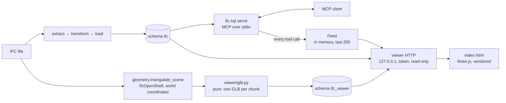

# Plan: a viewer for the loaded models and the MCP server's queries

- Status: proposed, not started
- Date: 2026-11-22
- For: a separate session that implements it, one pull request per phase
- Decisions to record: a new ADR 14, an amendment to ADR 6 decision 1, and SECURITY.md

## The goal

An `index.html` page, served by `ifc-sql` on the user's own machine, that:

1. **shows a loaded model in 3D** right after `ifc-sql ingest`, with no other program; and
2. **shows what the LLM asked through the MCP server, live**: every tool call (the tool,
   its arguments, the SQL of `run_sql`, how many rows came back), with the elements it
   found highlighted in the model.

The core goal, for the repository and for the page: **a clear demo on the reference
sample files**, the four buildingSMART Duplex models and the audit's five Revit
2019–2022 exports. Where a choice trades generality against a clear demo on those files,
the demo wins.

## Verdict: it fits the pipeline, but five of the project's own rules stand in the way

The pieces are mostly there already:

- the pipeline triangulates shapes with IfcOpenShell (`ingest/geometry.py`, `_triangulated`,
  already with a `world=True` mode);
- every tool call goes through one function, `_Calls.tool` in `server/app.py`;
- every object has its GlobalId (`ifc.object.global_id`, unique per model);
- the locked MCP SDK (`mcp` 2.3.0) already brings Starlette 1.10.0, uvicorn 0.54.0 and
  sse-starlette 3.7.0, so no new runtime dependency is needed, and it exposes
  `MCPServer.run_stdio_async()`, so a web server can share the stdio server's event loop.

What stands in the way, and what the plan does about each:

| # | What the code says now | Where | What the viewer needs |
|---|---|---|---|
| 1 | The database keeps the file's base name, size and SHA-256, never its path or its bytes | `db/schema.py`, table `model` | The viewer cannot go back to the file. The geometry has to be made at ingest, while the file is open, and stored. |
| 2 | "stdio is the only transport … the HTTP transport would bring authentication, origin checks and a listening port" | ADR 6 decision 1; SECURITY.md, "What is not protected" | A viewer is a listening port. ADR 14 amends ADR 6 and accepts the port under conditions: loopback only, opt-in, a token per start, a Host check, read-only. It is not an MCP transport. |
| 3 | stdout carries only JSON-RPC | ADR 6 context 5; `test_serve_stdio.py` | A web server inside `serve` must never print anything: uvicorn with `log_config=None` and `access_log=False`, logging through the project's stderr logger. |
| 4 | Every new table in schema `ifc` is readable by `ifc_reader`, and so by `run_sql` (`ALTER DEFAULT PRIVILEGES` in migration 0003) | `0003_create_reader_role.py`, `sql_guard.py` | The geometry blobs must not go in `ifc`: a `run_sql` on them would compute megabytes of hex. A separate schema, `ifc_viewer`, is invisible to `run_sql` (the validator allows only `ifc`) and to `describe_schema`, and `ifc_reader` can still read it. |
| 5 | Only `extract` and `geometry` touch IfcOpenShell; transform is pure | `ingest/geometry.py` docstring; the mypy override comment in `pyproject.toml` | The triangulation goes in `geometry.py`. The GLB writer is a pure module that takes plain records, as transform does. |

And two costs to accept:

- **Time.** Triangulating every element costs about what `--geometry` costs, which the
  README puts at "about a minute for 15,000 objects on 4 cores". So, like `--geometry`, it
  runs on request: `ingest --viewer`. If step 0 shows a Duplex-sized file takes a second
  or two, it can become the default instead.
- **Coverage.** pytest cannot measure browser code, and the Python code is at 100 %
  branch coverage. The JavaScript stays thin, every rule that can live in Python does,
  and a browser test (Phase 4) checks the page.

## What the user gets

```powershell
uv run ifc-sql ingest data\samples\Duplex_A_20110907.ifc --discipline ARC --viewer
# loaded … as model 1 (ARC): …; scene: <n> elements in <k> chunks, <MB>, <s>  (figures from step 0)
uv run ifc-sql view     # opens http://127.0.0.1:<port>/?t=<token> in the browser
```

For the MCP client, one more environment variable turns the viewer on inside `serve`:

```powershell
claude mcp add --env IFC_SQL_VIEWER_PORT=0 --env IFC_SQL_DATA_DIR=… --transport stdio ifc-sql -- <uv> run --directory <repo> ifc-sql serve
```

The LLM calls `show_in_viewer` and hands the user the link. From then on, every
`find_elements`, `get_element`, `space_schedule`, `data_quality_report` and `run_sql` call
appears in the page's feed, and its elements are highlighted.

```
┌──────────────────────┬──────────────────────────────────────────┬─────────────────────┐
│ Model  [1 ARC ▾]     │                                          │ Selected            │
│ Storeys              │                                          │ Door 'M_Single-…'   │
│  ☑ Level 2  3.100 m  │            3D view (three.js)            │ IfcDoor · Level 1   │
│  ☑ Level 1  0.000 m  │      selection in the accent colour,     │ Revit type …        │
│ Classes  ☑ Walls …   │      the rest ghosted                    │ width 0.915 m       │
│──────────────────────│                                          │ GlobalId [copy]     │
│ MCP feed   [follow ☑]│                                          │                     │
│ 14:02 find_elements  │                                          │                     │
│   IfcDoor, "Level 1" │                                          │                     │
│   → 14 · 14 shown    │                                          │                     │
│ 14:01 run_sql ▸ SQL  │                                          │                     │
│   → 23 rows · 23 ids │  [fit] [fit selection] [only selection]  │                     │
└──────────────────────┴──────────────────────────────────────────┴─────────────────────┘
```

## Architecture



## Design, to record in ADR 14

### 1. A scene per model, built at ingest, in its own schema

- **Migration 0020** creates schema `ifc_viewer` with two tables, each table and column
  commented as the rest of the schema is:
  - `scene`: one row per model. `model_id` (primary key, foreign key to `ifc.model`,
    `ON DELETE CASCADE`), `format_version`, `built_at`, `build_seconds`,
    `ifcopenshell_version`, `origin_x_m`, `origin_y_m`, `origin_z_m`, `element_count`,
    `without_shape_count`, `byte_count`.
  - `scene_chunk`: primary key `(model_id, chunk_no)`, `storey_id` (foreign key to
    `ifc.spatial_element`, null for elements without a storey), `kind` (`elements` or
    `spaces`), `element_count`, `glb` (`bytea`), `glb_sha256`.
  - `GRANT USAGE ON SCHEMA ifc_viewer` and `SELECT` on both tables to `ifc_reader`, plus
    default privileges for the schema, as 0003 does for `ifc`. The downgrade drops the
    schema.
- **Format: glTF 2.0 binary (GLB)**, Y-up, metres. Positions are float32 relative to the
  model's origin (the centre of its bounding box, rounded to whole metres) and the origin
  is stored in float64. Revit files placed at survey coordinates far from 0 then do not
  jitter, and the models of one project line up when the page subtracts one origin from
  another.
- **One glTF node per element**, `name` = GlobalId, `extras` = `{ifc_class, object_id}`.
  One primitive per IfcOpenShell material, with its diffuse colour and transparency, and a
  colour per class where the file has none.
- **What goes in:** every `IfcElement` with a body, except feature elements. Openings are
  already cut from their walls, because `disable-opening-subtractions` stays off. Spaces
  (`IfcSpace`) go in chunks of kind `spaces`, hidden until a selection includes one.
- **Chunks follow the storeys of the loaded model** (`ifc.element.storey_id`), so a chunk
  holds exactly what `list_storeys` counts and the page can load and toggle storey by
  storey. A storey larger than a cap (for example 2,000 elements or 16 MB) is split into
  several chunks. Elements without a storey get their own chunk.
- **The writer is our own** (`viewer/glb.py`): pure, standard-library `struct`/`array`,
  with deterministic bytes. The alternative is IfcOpenShell's own serializer: the wrapper
  in the locked 0.9.0.post1 wheel has `ifcopenshell.geom.serializers.gltf` and a
  `use-element-guids` setting, but step 0 has to show that the compiled library actually
  includes it. I recommend our own writer, because of the chunking, the origin, the node
  extras and testability. Switch only if step 0 shows the serializer is much faster on
  file B and our writer is too slow.
- **In the pipeline:**
  - `ingest --viewer` builds the scene after the load commits, in its own transaction,
    with the model row locked (as `_measure_in_place` does).
  - For a file that is already loaded, it builds the scene in place, as ADR 12 measures
    in place.
  - A model whose scene is at the current `format_version` keeps it. An older one is
    rebuilt.
  - A failed build writes nothing, reports the error and exits 1. The model stays loaded.
  - `watch --viewer` does the same for every file it loads.
- **Not an `ingestion_run`.** A scene writes nothing to schema `ifc`, can be rebuilt at
  any time, and its own row records when it was built and how long it took. ADR 14 should
  name the rejected alternative: a `scene_seconds` column on `ingestion_run`, which would
  keep "every attempt is recorded" literal.
- **No new data quality rule.** Elements without a shape are counted on the scene row,
  and the page says so ("3 of 12 have no shape").

### 2. One web app, run two ways

- `viewer/http.py` is a Starlette app factory, `create_app(engine, token, feed=None)`.
- **`ifc-sql view`** runs it on its own, without MCP. It connects as `ifc_reader` and
  checks the revision as `serve` does, takes a free port (`--port`), prints the URL and
  opens the browser (`--no-open` to skip that).
- **`ifc-sql serve`** with `IFC_SQL_VIEWER_PORT` set (`0` means any free port) runs
  `server.run_stdio_async()` and `uvicorn.Server.serve()` in one anyio task group. When
  the client closes stdin, the viewer stops too.
  - Each server process gets its own port and token, so two clients never collide.
  - A fixed port that is already taken fails at startup, as ADR 6 decision 3 does for the
    database.
- Handlers read the database through `anyio.to_thread.run_sync`, in `reader_transaction`
  with the usual limits, so the stdio loop never waits on them.

### 3. What the listening port must hold

- It binds to `127.0.0.1` only, and no setting can change that.
- **Host check:** only `127.0.0.1:<port>` and `localhost:<port>` are accepted, which stops
  DNS rebinding. The SDK's `mcp.server.transport_security.TransportSecurityMiddleware`
  makes this check for its own HTTP transport, and can be reused or copied.
- **Token:** a new `secrets.token_urlsafe(32)` on every start.
  - `/?t=<token>` sets an `HttpOnly`, `SameSite=Strict` cookie and redirects to `/`.
  - Every other route needs that cookie, compared with `hmac.compare_digest`.
- **Methods:** GET only. Phase 4's picking adds one POST, which also checks `Origin`.
- **Headers:**
  - a CSP of `default-src 'none'; script-src 'self' 'sha256-<import map>'; style-src
    'self'; img-src 'self' data: blob:; connect-src 'self'; frame-ancestors 'none';
    base-uri 'none'; form-action 'none'`;
  - `X-Content-Type-Options: nosniff` and `Referrer-Policy: no-referrer`;
  - `Cache-Control: no-store` on `/api`;
  - no CORS headers.
- **IFC text stays data in the page too.** It is rendered with `textContent`, never
  `innerHTML`. A unit test fails if the project's own JavaScript (not the vendored files)
  uses `innerHTML`, `outerHTML`, `insertAdjacentHTML`, `eval` or `new Function`.
- **The token reaches the conversation** when `show_in_viewer` returns the link, and the
  client keeps the transcript. The token works only on this machine, and only while this
  server runs. SECURITY.md says so. `IFC_SQL_VIEWER_OPEN=1` makes the server open the
  browser itself, so the link never enters the conversation.
- **Events stay in memory.** The last 200, including the text of `run_sql` queries, are
  never written to disk, and the log is unchanged (ADR 6 decision 10).

### 4. The feed: every tool call, and what it found

- **`viewer/feed.py`** holds a `Feed`: a lock-protected `deque(maxlen=200)` of numbered
  `ViewerEvent`s. The SSE handler checks it every 250 ms, so no signalling between
  threads is needed, and `Last-Event-ID` lets a page that reconnects pick up where it left
  off.
- **The hook is `_Calls`.** `_Calls.__init__(engine, limits, feed=None)`, and
  `_Calls.tool` publishes one event after every call, successful or not (a failed call
  has no selection). The tool functions pass their arguments to it as a new `arguments=`
  parameter; today they pass only `log_fields`.
- **The summary is built by the server** from the arguments, never from IFC content. For
  example: `find_elements: IfcDoor on "Level 1", model 1 → 14`.
- **What each tool selects:**

| Tool | What is highlighted |
|---|---|
| `find_elements` | The filter itself, resolved when the page asks to every match (capped at 20,000), not just the page of 100. `tools.find_element_ids` shares the WHERE clause builder with `find_elements`, so the two can never disagree. |
| `get_element` | The one object, and the camera zooms to it. |
| `space_schedule` | The spaces listed (up to 500), with the spaces layer shown. |
| `data_quality_report` | The objects of the sample findings (up to 20 per rule). |
| `run_sql` | The values of result columns named `global_id` (paired with `model_id` when that column is there; GlobalIds are unique per model only) or `object_id`, up to 500 rows. |
| `show_in_viewer` | The GlobalIds it is given. |
| `list_models`, `list_storeys`, `quantity_takeoff`, `schedule`, `compare_models`, `describe_schema` | Nothing; they appear in the feed only. |

- When the viewer is on, `run_sql`'s description gains one sentence: "Select model_id and
  global_id to see the rows in the viewer."

### 5. One new tool, only when the viewer runs

`show_in_viewer(model_id, global_ids = [] (at most 5,000), label = None)` returns
`{url, model_id, shown, without_shape}`. It is registered only when the viewer runs, so
the server has 12 tools with the viewer and 11 without. `test_serve_stdio.py`,
`test_mcp_smoke_script.py` and `scripts/mcp_smoke.py` pin both counts.

### 6. The page

- **Plain ES modules, no build step and no npm:**
  - `index.html`, `viewer.css`;
  - `main.js`;
  - `scene.js`: loads the chunks, highlights, ghosts the rest, fits the view;
  - `feed.js`: an `EventSource`, the list of calls, applying a selection;
  - `details.js`: on a click, calls `/api/models/{id}/objects/{global_id}` (which runs
    `tools.get_element`) and renders the answer with `textContent`;
  - `api.js`: the one seam for transport. It uses fetch and `EventSource` now, and could
    use MCP Apps' postMessage later.
- **three.js is vendored** in `viewer/static/vendor/three/`: the module build,
  `GLTFLoader`, `OrbitControls` and `BufferGeometryUtils`.
  - It is pinned to one release (r159 or later, for `BatchedMesh`), with SHA-256 sums in
    `SHA256SUMS`, which a unit test checks.
  - `scripts/vendor_three.py` fetches it, the way `download_samples.py` fetches the
    samples.
  - Its MIT licence sits next to it and is named in the README's Licences section.
  - There is no CDN, so the page works offline, as the rest of the tool does.
- **Highlighting:** the selection in an accent colour and everything else ghosted (grey,
  15 % opacity). Buttons for "only the selection" and "fit to the selection". A count
  line: "14 found · 14 shown · 0 without shape".
- **Performance:** one draw call per primitive is fine for the Duplex files. Measure file
  B (15,000 objects). If it renders below about 30 frames per second on a laptop, move to
  one `THREE.BatchedMesh` per chunk, which sets colour and visibility per element in a
  single draw call.

### 7. MCP Apps, later and only after a spike

The locked SDK ships `mcp.server.apps.Apps` (extension `io.modelcontextprotocol/ui`). With
it, a tool names a `ui://` HTML resource that the host renders inside the conversation,
and `show_in_viewer` could be that tool. Two things are unknown:

- The iframe is sandboxed, so the geometry would have to come through the host, as base64
  from an app-only tool (`visibility=["app"]`). Hosts' size limits for that are unknown.
- A terminal client cannot show the page at all.

The seam in `api.js` keeps the option open. Phase 5 is a spike that ends in a go or no-go.

## Phases

For every phase:

- a branch from `main` and one pull request;
- `make check` green, at 100 % branch coverage;
- docs that quote figures updated with measured ones, pinned by the sample tests as the
  rest of the docs are;
- commit messages in the conventional style `git log` shows (`feat(viewer): …`,
  `docs(adr): …`).

### Phase 0: spike (no PR; the findings go into ADR 14)

1. Triangulate every element of Duplex ARC, Duplex MEP and the audit's file B
   (`make audit-samples`) in world coordinates, with `_triangulated(world=True)` over all
   `IfcElement`s. Record the seconds, triangles and vertices of each.
2. Write a GLB both ways: a sketch of our own writer, and
   `ifcopenshell.geom.serializers.gltf` with `use-element-guids` and `y-up`. Compare the
   seconds and the bytes. Open each in a throwaway three.js page and check the
   orientation, the openings cut from walls, the colours, and that node names are
   GlobalIds.
3. Show that `run_stdio_async` and `uvicorn.Server.serve()` in one anyio task group keep
   stdout clean and both stop when stdin closes, on Windows as well as Linux.
4. Decide: which writer, whether `--viewer` stays opt-in, and the chunk caps.

Done when: the figures are written down, and the four decisions are made.

### Phase 1: scenes in the pipeline (PR 1)

**Files**

| File | Change |
|---|---|
| `src/ifc_sql_mcp/db/migrations/versions/0020_add_viewer_scenes.py` | New: the schema, both tables, the grants and the downgrade. Use `0019_add_space_plans.py` as the template. |
| `src/ifc_sql_mcp/db/schema.py` | Add `VIEWER_SCHEMA = "ifc_viewer"` and the tables `scene` and `scene_chunk`, with `schema=VIEWER_SCHEMA`. |
| `src/ifc_sql_mcp/ingest/raw.py` | Add `RawMesh`: GlobalId, positions, indices, and the material of each group of faces. |
| `src/ifc_sql_mcp/ingest/geometry.py` | Add `triangulate_scene(model, threads)`, built on `_triangulated(world=True)`. |
| `src/ifc_sql_mcp/viewer/__init__.py`, `viewer/glb.py`, `viewer/scene.py` | New. `glb.py` is the pure writer. `scene.py` turns meshes into chunks, sets the origin and makes the rows. |
| `src/ifc_sql_mcp/ingest/load.py` | Add `add_scene(connection, model_id, chunks)`. |
| `src/ifc_sql_mcp/ingest/pipeline.py` | Add `viewer: bool` to `ingest_file`, and a `scene` outcome to `IngestResult`. |
| `src/ifc_sql_mcp/cli.py`, `src/ifc_sql_mcp/watch.py` | Add `--viewer` to `ingest` and `watch`, with one more phrase in the summary line. |

**Tests**

- **Unit** (`tests/unit/viewer/test_glb.py`):
  - the header has the magic `glTF`, version 2 and the right length;
  - chunks are aligned to 4 bytes, and the JSON chunk parses;
  - the POSITION accessor has `min` and `max`;
  - node names are the GlobalIds;
  - Y is up, and the origin offset is applied;
  - an empty scene works, and the same input gives the same bytes.
- **Integration:**
  - `test_migrations`: `compare_metadata` with `include_schemas=True`, and the constraints
    of the new tables;
  - `test_privileges`: `ifc_reader` can read `ifc_viewer.*` and cannot write it;
  - `test_run_sql`: `ifc_viewer.scene_chunk` is refused;
  - `test_schema_discovery`: `describe_schema` does not list it;
  - `ingest --viewer` on `tests/support/geometry_model.py`: the wall, slab, space and
    column are in the scene, the opening is not, and the point-bodied beam counts as
    "without shape";
  - building in place on a file already loaded, keeping a current scene, rebuilding an
    older `format_version`;
  - a failed build leaves no row, and deleting the model deletes its scene;
  - two builds at once: one wins, staged with a blocked transaction as `test_ingest`
    stages its races.
- **Samples:** pinned figures for Duplex ARC (elements, chunks, bytes).

**Docs:** `docs/data-model.md` (a section on the `ifc_viewer` schema); the README
(`ingest --viewer`, the repository layout); ADR 14 decision 1, with the step 0 figures.

**Done when:** `uv run ifc-sql ingest … --viewer` writes a scene, and `make check` is
green.

### Phase 2: `ifc-sql view` and the page (PR 2)

**Files:**

- `viewer/http.py`: the app factory and the routes below;
- `viewer/security.py`: the token, the Host check and the headers, as middleware;
- `viewer/static/*` and `viewer/static/vendor/three/*`;
- `scripts/vendor_three.py` and `scripts/viewer_smoke.py` (modelled on `mcp_smoke.py`);
- `cli.py`: the `view` command;
- `config.py`: `IFC_SQL_VIEWER_PORT` (an integer from 0 to 65535, unset means off) and
  `IFC_SQL_VIEWER_OPEN`;
- `pyproject.toml`: `starlette` and `uvicorn` as direct dependencies with loose bounds
  around the locked versions (`>=1.10,<2` and `>=0.54,<1`), so a future `mcp` upgrade
  does not conflict. Then run `uv lock` without upgrading anything else;
- `Makefile`: `view` and `viewer-smoke`;
- CI: `viewer_smoke.py` in the `check` job and the `windows` job.

| Route | Returns |
|---|---|
| `GET /` | `index.html`. With `?t=`, it sets the cookie and redirects. |
| `GET /static/{path}` | The page's own files only: no listing, no `..`. |
| `GET /api/models` | `tools.list_models`, plus whether each model has a scene. |
| `GET /api/models/{id}/scene` | The manifest: the origin, and each chunk's number, storey, kind, element count, bytes and hash. |
| `GET /api/models/{id}/scene/{chunk_no}.glb` | The chunk as `model/gltf-binary`, with `ETag` = `glb_sha256`. |
| `GET /api/models/{id}/objects/{global_id}` | `tools.get_element`, with its usual clipping. |
| `GET /api/events`, `GET /api/events/{seq}/selection` | Phase 3. |

**Tests:** run the real uvicorn on a free port in a thread and call it with the standard
library's `http.client`. That means no mocks and no new dev dependency: Starlette's
`TestClient` needs `httpx`, which is not in the lock (the SDK uses `httpx2`). The cases:

- a foreign Host header is refused;
- a missing or wrong token is refused;
- the token redirect sets the cookie with the right flags;
- every response carries every security header;
- POST gets 405, and path traversal gets 404;
- an unknown model gets 404 with a message saying what to do;
- a model without a scene gets 404 with "run ifc-sql ingest --viewer";
- a chunk's bytes equal the database's, and the `ETag` gives a 304;
- the project's own JavaScript contains no `innerHTML`;
- the vendored files match `SHA256SUMS`;
- the CSP hash matches the import map in `index.html`.

**Docs:**

- `docs/viewer.md` (new);
- SECURITY.md: the port, the token and the page;
- ADR 14 decisions 2, 3 and 6;
- ADR 6's status line: "decision 1 amended by ADR 14";
- `docs/windows.md`: `view` in PowerShell;
- the README.

**Done when:** `uv run ifc-sql view` shows Duplex ARC in a browser on Windows, and the
viewer smoke test passes in CI on Linux and Windows.

### Phase 3: the MCP feed (PR 3)

**Files:**

- `viewer/feed.py`;
- `server/app.py`: the `_Calls` hook and its `arguments=`, `show_in_viewer`, the extra
  sentence in `run_sql`'s description, and `build_server(…, feed=None)`;
- `server/tools.py`: move the WHERE clause builder out of `find_elements` and add
  `find_element_ids`;
- `cli.py`: `serve` with the task group;
- `viewer/static/feed.js`;
- `scripts/mcp_smoke.py`: a run with the viewer on.

**Tests:**

- the feed's bound, order and concurrency (publishing from several threads);
- the selection of each tool, as in the table above;
- `test_serve_stdio` with the viewer on: stdout carries only JSON-RPC, and there are 12
  tools;
- a `find_elements` whose answer has three pages resolves to every match;
- a `run_sql` with a `global_id` column gives its ids;
- a failed call appears with its outcome and no selection;
- the SSE stream gives the events in order and resumes with `Last-Event-ID`;
- a fixed port that is taken exits 1 with a message;
- closing stdin stops the web server.

**Docs:**

- `docs/mcp.md`: `show_in_viewer`, `IFC_SQL_VIEWER_PORT` in the variables table, and
  registering the server with the viewer on;
- ADR 14 decisions 4 and 5;
- the tool counts in the README and in `app.py`'s docstring ("eleven tools, twelve with
  the viewer").

**Done when:** in Claude Code with `IFC_SQL_VIEWER_PORT=0`, the prompt "show me the doors
on Level 1 of model 1" puts the call in the feed and highlights the doors.

### Phase 4 (optional): a browser test, and picking back to the LLM

- **Browser test:** Playwright for Python, in a separate CI job, `viewer-browser`. It
  loads Duplex ARC, waits for `window.ifcViewer.ready`, publishes an event and checks the
  highlighted count through a test hook. This needs `playwright` as a dev dependency and
  `playwright install chromium` in CI.
- **Picking:** a click in the page sends `POST /api/picked` (token cookie and `Origin`
  check). A `viewer_selection` tool returns what the user picked, so the user can ask
  "tell me about the wall I clicked".

### Phase 5 (optional): an inline viewer through MCP Apps, after a spike

See design decision 7. First test what Claude Desktop accepts as an app-only tool result
(the size of one chunk in base64), then decide.

## Open questions

Each has a default the plan uses. Confirm them before Phase 1.

1. **`--viewer` opt-in or on by default?** Default: opt-in, as `--geometry` is. Revisit
   with the step 0 figures.
2. **Which client matters most?** Default: the localhost page, which works next to any
   client. MCP Apps (Phase 5) only if seeing the viewer inside Claude Desktop or claude.ai
   is wanted.
3. **Several discipline models of one project in one view?** Default: Phase 2 shows one
   model at a time. Adding the other current models of its `project_group` is a small
   step, because the stored origins line them up.
4. **Picking back to the LLM (Phase 4)?** Default: later.
5. **A fixed URL to bookmark?** Default: a new port and token on every start.

## Risks

- **IfcOpenShell fails on some Revit bodies.** Those elements are counted as without a
  shape, not treated as fatal (as `geometry_not_measured` is today).
- **Large chunks.** One storey of file B can be large. The caps from step 0 split it, so
  no single `bytea` gets out of hand and the 5-second statement timeout holds.
- **Browser memory on file B.** Measure it in step 0 and in Phase 2. `BatchedMesh` is the
  answer if needed.
- **Sessions.** `ifc_reader`'s `CONNECTION LIMIT 20` is shared with MCP calls. The page
  fetches chunks one after another, and each handler opens one session.
- **Coverage on Windows.** `serve`'s task group has to be covered on Windows too: the
  `windows` CI job runs the viewer smoke test.

## Start here (for the session that implements this)

**Read first:**

- this plan;
- ADR 6, ADR 10, ADR 12 and SECURITY.md;
- in `server/app.py`: `_Calls` and `build_server`;
- `ingest/geometry.py`;
- in `ingest/pipeline.py`: `ingest_file` and `_measure_in_place`;
- `db/migrations/versions/0019_add_space_plans.py`;
- `tests/support/geometry_model.py`.

**Set up on Windows, in PowerShell** (`docs/windows.md`):

```powershell
uv sync --locked --extra embedded
$env:IFC_SQL_DATA_DIR = "$env:LOCALAPPDATA\ifc-sql\data"
uv run ifc-sql migrate
uv run python scripts/download_samples.py
uv run ifc-sql ingest data\samples\Duplex_A_20110907.ifc --discipline ARC
```

**Checks** (what `make check` and CI run):

```powershell
uv run ruff check .; uv run ruff format --check .; uv run mypy; uv run pytest --cov
```

The integration tests create throwaway databases on the PostgreSQL server named by
`IFC_SQL_DATABASE_URL` (`tests/conftest.py`). Run them against Docker (`make up`), or
rely on CI, which has a PostgreSQL 16 service.

**Conventions:**

- Google docstrings, `mypy --strict`, ruff with the bandit rules;
- no `print` outside `scripts/`, and `pathlib` over `os.path`;
- tests against real PostgreSQL, with nothing mocked in the safety layers;
- the figures in the docs come from commands and are pinned by the sample tests;
- one ADR per decision, with the alternatives that were rejected.
