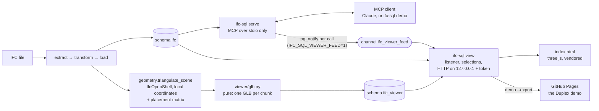

# Plan: a viewer for the loaded models and the MCP server's queries

- Status: revised after review ([the review](2026-11-ifc-viewer-review.md)), again
  after Phases 0 and 1 ([Changes after Phases 0 and 1](#changes-after-phases-0-and-1)),
  after Phase 2 ([Changes after Phase 2](#changes-after-phase-2)) and after Phase 3
  ([Changes after Phase 3](#changes-after-phase-3)). Phase 0 is done
  ([ADR 14](../adr/0014-viewer.md), accepted with Phase 3); Phase 1 is PR 1, Phase 2
  PR 2, Phase 3 PR 3.
- Date: 2026-11-22
- For: a separate session that implements it, one pull request per phase. This plan is
  complete on its own; the review records why it changed.
- Decisions to record:
  - a new ADR 14;
  - amendments to ADR 1 (a second schema), ADR 6 decisions 2 and 10 (the feed's
    notification) and ADR 13 decision 3 (`view` and `demo` attach to the embedded
    database);
  - SECURITY.md.

## The goal

An `index.html` page, served by `ifc-sql view` on the user's own machine, that:

1. **shows the loaded models in 3D**, every discipline of a project together, right after
   `ifc-sql ingest --viewer`, with no other program;
2. **shows what was asked through the MCP server**: every tool call (the tool, its
   arguments, the SQL of `run_sql`, the outcome), with the elements it found highlighted:
   - first from a **scripted demo**, `ifc-sql demo`, that drives the real server through
     the SDK's client, with no LLM and no MCP client, and that CI checks;
   - then **live** from the user's own MCP client (Claude Desktop, Claude Code);
3. and a **static copy of the scripted Duplex demo** on GitHub Pages, linked from the
   README, so a reader sees it without installing anything.

The core goal, for the repository and for the page: **a clear demo on the reference
sample files**, the four buildingSMART Duplex models (`scripts/download_samples.py`) and
the audit's five Revit 2019–2022 exports (`scripts/download_audit_samples.py`). Where a
choice trades generality against a clear demo on those files, the demo wins.

## The architecture in one paragraph

Scenes are built at ingest and stored in their own schema. `ifc-sql view` is the only
process that listens on a port. `ifc-sql serve` stays stdio-only, exactly as ADR 6
decision 1 says. With `IFC_SQL_VIEWER_FEED=1` it sends one PostgreSQL notification per
tool call, which every `view` on the same database receives. So one page shows the calls
of every client: the scripted demo, Claude Desktop and Claude Code. No link has to pass
through the conversation, and the MCP server keeps its eleven tools.



## What stands in the way, and what the plan does about each

| # | What the code says now | Where | What the viewer does |
|---|---|---|---|
| 1 | The database keeps the file's base name, size and SHA-256, never its path or its bytes. | `db/schema.py:200-208` | The geometry is made at ingest, while the file is open, and stored. |
| 2 | "stdio is the only transport" for the MCP server. | ADR 6 decision 1; SECURITY.md, "What is not protected" | `serve` keeps no port. The only port is `ifc-sql view`, a separate command that runs no MCP and no tool except `list_models` and `get_element`. ADR 6 decision 1 is unchanged. |
| 3 | Each call runs in one transaction that "always ends with a rollback". | `db/engine.py:70-98`; ADR 6 decision 2 | With the feed on, each call adds a second, short, **committed READ ONLY** transaction in its own session, which only calls `pg_notify`. ADR 14 amends ADR 6 decision 2 accordingly. |
| 4 | Every new table in schema `ifc` is readable by `ifc_reader`, and so by `run_sql`. | `0003_create_reader_role.py:131` | The scenes go in schema `ifc_viewer`. `run_sql`'s validator reads only `ifc`, so a query cannot compute megabytes of hex. `ifc_reader` gets explicit SELECT on the two new tables, because `view` reads them. |
| 5 | Only `extract` and `geometry` touch IfcOpenShell; transform is pure. | `ingest/geometry.py:27` (the mypy comment in `pyproject.toml:97-100` is stale: it still names extract alone) | The triangulation goes in `geometry.py`, called from `extract.read_model`. The GLB writer is a pure module that takes plain records. |
| 6 | `list_storeys` counts every `ifc.element` on a storey, openings included, and the database stores no link from an aggregate's part to the aggregate. | `server/tools.py:262-265`; `ingest/transform.py:177-216, 386-390`; ARC has 50 openings of 268 elements (`tests/samples/test_duplex_mcp.py:37`) | The scene keeps its own counts: drawn, without shape, openings not drawn. The GLB nests each part's node under its aggregate's, so selecting an `IfcCurtainWall` or `IfcStair` lights its parts. |
| 7 | The coverage gate is `fail_under = 85`, although the README says 100 %. The windows CI job measures no coverage. | `pyproject.toml:133`; `README.md:187`; `.github/workflows/ci.yml:130-180` | PR 1's first commit sets `fail_under = 100`. Code that differs on Windows is tested in-process on Linux; the windows job runs `demo --check`. |

And three costs to accept:

- **Time.** Triangulating every element costs more than `--geometry`, which triangulates
  only the measured classes (`geometry.py:46-60`). Measured with `--geometry` on file B:
  54 s for 8,285 shapes on 4 cores (`docs/audit/2026-11-implementation.md:617`), and 59.5 s
  in the round-2 figures (`docs/audit/evidence/figures_after.md:53`). Phase 0 measured
  the scene of B's 11,297 drawn elements: 26.8 s on 4 threads, triangulated in local
  coordinates, and one pass serves `--geometry` too (28.8 s for both, ADR 14, P1). That
  is three times B's extract and transform, so `--viewer` stays opt-in (P2), and every
  documented demo path passes it.
- **Coverage.** pytest cannot measure browser code. The JavaScript stays thin, every rule
  that can live in Python does, and a browser test (Phase 6) checks the page.
- **Feed confidentiality.** A notification can be read by any session on the database
  that LISTENs to the channel, and any login can send one ("Notifications are visible to
  all users", [NOTIFY](https://www.postgresql.org/docs/16/sql-notify.html)). The feed is
  opt-in, carries arguments and clipped SQL text, never IFC content, and `view` treats
  every event as untrusted. SECURITY.md says so.

## What the user gets

From a fresh clone, Windows, PowerShell, embedded database:

```powershell
uv sync --locked --extra embedded
$env:IFC_SQL_DATA_DIR = "$env:LOCALAPPDATA\ifc-sql\data"
uv run python scripts/demo.py
# downloads the Duplex, migrates, loads the four files with --viewer, checks them,
# opens http://127.0.0.1:<port>/#t=<token> and plays the questions
```

Linux: `make install demo`, after `make up` or with `IFC_SQL_DATA_DIR` set. To try it
with a live LLM afterwards:

```powershell
uv run ifc-sql view      # keep it open; it prints and opens the page
# then register the server with IFC_SQL_VIEWER_FEED=1 (docs/mcp.md) and ask
```

```
┌───────────────────────────┬─────────────────────────────────────────────┬──────────────┐
│ Project [Duplex Apart. ▾] │ find_elements · IfcWall on "Level 1" · ARC  │ (drawer,     │
│ [ARC] [MEP] [ELE] [PLU]   │ 21 found · 21 shown · 0 without shape       │  opens on a  │
│ Storeys                   │ Level 2, Roof hidden · show all             │  click)      │
│  ☑ Roof      6.000 m      │                                             │ Wall 'Basic  │
│  ☑ Level 2   3.100 m      │          3D view (three.js)                 │  Wall:…'     │
│  ☑ Level 1   0.000 m      │   selection in accent colours by group,     │ IfcWall…     │
│  ☑ T/FDN    -1.250 m      │   the rest opaque light grey                │ Level 1      │
│───────────────────────────│                                             │ GlobalId     │
│ Feed ● live · scripted    │                                             │  [copy]      │
│ 14:02 find_elements …  21 │                                             │              │
│ 14:01 run_sql ▸ SQL    23 │                                             │              │
│ 14:01 list_models       – │ [fit] [fit selection] [only selection]      │              │
└───────────────────────────┴─────────────────────────────────────────────┴──────────────┘
```

## Design, to record in ADR 14

### 1. A scene per model, built at ingest, in its own schema

- **Migration 0020** creates schema `ifc_viewer` with two tables, each table and column
  commented as the rest of the schema is. Use 0001 and 0005 as templates for tables and
  comments, and 0003 for grants. 0019 only adds columns.
  - `scene`: one row per model.
    - `model_id`: primary key, foreign key to `ifc.model`, `ON DELETE CASCADE`.
    - `format_version`, `built_at`, `build_seconds`, `ifcopenshell_version`.
    - `origin_x_m`, `origin_y_m`, `origin_z_m`, as `double precision`.
    - `element_count` (drawn), `without_shape_count`, `opening_count` (feature elements,
      not drawn) and `byte_count`.
  - `scene_chunk`: primary key `(model_id, chunk_no)`.
    - `storey_id`: a foreign key to `ifc.spatial_element`, deferrable and initially
      deferred, as `_within_model` does (`db/schema.py:164-173`). Null for elements
      without a storey.
    - `kind`: `elements`, `spaces`, `space_copies` or `areas`.
    - `element_count`, `glb` (`bytea`) and `glb_sha256`.
  - `GRANT USAGE ON SCHEMA ifc_viewer` and `SELECT` on both tables to `ifc_reader`, as
    explicit grants. No default privileges: `test_migrations.py:121-124` pins one default
    ACL.
  - The downgrade drops the schema.
- **Format: glTF 2.0 binary (GLB)**, Y-up, metres.
  - Positions are float32, relative to the model's origin: the centre of its bounding
    box, rounded to whole metres. The origin is stored in float64. Revit files placed at
    survey coordinates far from 0 then do not jitter, and the page lines models up by
    subtracting one origin from another.
  - POSITION and indices only. No NORMAL: three.js shades a primitive without normals
    flat. IfcOpenShell's `weld-vertices` already discards normals.
  - No textures, no Draco, no meshopt, so the page needs no WASM and no `blob:`.
- **Nodes.**
  - One glTF node per element: `name` = GlobalId, `extras` = `{ifc_class}`. No
    `object_id`, which would tie the bytes to one database.
  - One primitive per IfcOpenShell material, with its diffuse colour and transparency.
    `apply-default-materials` (on by default) already colours elements whose file gives
    none.
  - **Aggregates:** when an element aggregates parts that have bodies (`IfcCurtainWall`
    → plates and members, `IfcStair` → flights, `IfcRamp`, `IfcRoof`,
    `IfcElementAssembly`), the parts' nodes become children of the aggregate's node, and
    the aggregate's own body, if any, is left out. Selecting the aggregate's GlobalId
    selects its children. The file is open at build time, so the links come from
    `IfcRelAggregates` without a schema change.
- **What goes in.**
  - Every `IfcElement` with a body, except feature elements. Openings are already cut
    from their walls, because `disable-opening-subtractions` stays off (its default).
  - Spaces go in chunks of kind `spaces`, hidden until a selection includes one. A space
    that repeats another (`spatial_element.repeats_id` set; the Duplex MEP model's 21
    "MEP Space" copies, file C's 75) goes in `space_copies`. Revit area plans (category
    `Areas`; 25 on file E) go in `areas`. Neither is ever drawn unless selected, so
    copies do not z-fight with their rooms.
  - Spaces are placed by `spatial_element.parent_id`, elements by
    `ifc.element.storey_id`.
- **Chunks follow the storeys**, so the page can load and toggle storey by storey.
  - A storey above a cap is split into several chunks. Phase 0 set the caps: 2,000
    elements or 16 MB (ADR 14, P3). They split file C's Level 1 (3,314 elements drawn)
    and file E's Plan 01 (2,659).
  - Elements without a storey get their own chunk.
- **The writer is our own** (`viewer/glb.py`): pure, with deterministic bytes.
  - Meshes are sorted by STEP id first: `_triangulated` yields shapes as its worker
    threads finish them (`geometry.py:138-147`).
  - The JSON is written with `sort_keys`.
  - `RawMesh` holds the bytes of the wrapper's `verts_buffer`, `faces_buffer` and
    `material_ids_buffer`, not tuples of floats (memory on file B). Use `array` or numpy,
    as `ingest/footprints.py:30` does.
  - IfcOpenShell's glTF serializer is rejected. It is compiled into the locked wheel (the
    `ifcopenshell_geometry_glb` plugin), but it writes only to a file path, ignores
    `y-up` (always Y-up), writes no `extras`, and makes one file per run, so chunks per
    storey would need one run each.
- **In the pipeline.**
  - `extract.read_model(path, geometry=…, viewer=…)` gains `viewer`, and `RawModel` gains
    `meshes`.
  - With `viewer`, `geometry.triangulate_scene(model, threads)` triangulates the elements
    and the spaces once, each in its local coordinates, and moves the vertices to world
    coordinates with the shape's placement matrix (`ifcopenshell.util.shape.get_shape_matrix`),
    in numpy: 1.4 to 4 times faster than `use-world-coords`, with the same triangles
    (ADR 14, P1). The space plans that every ingest makes (`measure_space_plans`) and,
    with `--geometry`, the measures are then made from the same shapes, not from a second
    pass.
  - `ingest --viewer` builds the scene after the load commits, in its own transaction,
    with the model row locked (as `_measure_in_place` does, `pipeline.py:274-279`).
  - On a file already loaded, `ingest --viewer` builds the scene in place, as ADR 12
    measures in place. It re-reads the file, writes only `ifc_viewer`, and adds a third
    flag to the skip branch and its warning (`pipeline.py:167-178`).
  - A model whose scene is at the current `format_version` keeps it. An older scene is
    replaced when `ingest --viewer` runs on its file; nothing rebuilds it on its own.
  - Two builds at once: the model-row lock decides; the loser finds the scene and skips.
  - A failed build writes nothing, reports the error and exits 1. The model stays loaded.
  - `watch --viewer` passes the flag on.
- **Not an `ingestion_run`.** A scene writes nothing to schema `ifc`, can be rebuilt at
  any time, and its own row records when it was built and how long it took. ADR 14
  names the rejected alternative: a `scene_seconds` column on `ingestion_run`.
- **No new data quality rule.** The scene's counts are shown on the page. On the Duplex
  ARC model, as Phase 0 counted them: "268 elements: 218 drawn, 0 without shape, 50
  openings not drawn" (215 with a body, and two stairs and a roof drawn through their
  parts).

### 2. `ifc-sql view`: the only port

- `viewer/http.py` is a Starlette app factory, `create_app(engine, token, feed)`.
- **`ifc-sql view [--project GROUP] [--model ID …] [--port N] [--no-open]`**:
  - connects as `ifc_reader` and checks the revision as `serve` does (`cli.py:433-446`);
  - shows the current models of one `project_group`: by default that of the most recently
    loaded model, with a picker for the others; `--model` names models directly;
  - lists models without a scene, greyed out, with "run ifc-sql ingest <file> --viewer";
  - prints the URL and opens the browser (`--no-open` skips that).
- **uvicorn**, run on the main thread in the normal way:
  - `view` binds the socket on `127.0.0.1` itself (port 0, the default, gives a free
    one) and passes `sockets=[sock]`. A taken port is then a catchable `OSError`, so
    `view` prints a message and exits 1. A bind failure inside uvicorn calls
    `sys.exit(3)` (`uvicorn/server.py:184-192`).
  - `lifespan="off"`, `access_log=False`, `log_config=None` (logging goes through the
    project's stderr logger), `timeout_graceful_shutdown=2`.
  - The SSE route uses sse-starlette's `EventSourceResponse`, which ends its streams
    once uvicorn's `should_exit` is set.
- **Database work** in the handlers runs through `anyio.to_thread.run_sync` with one
  `anyio.CapacityLimiter(3)`, in `reader_transaction` with the usual limits. `ifc_reader`
  allows 20 sessions, shared with every MCP call on the cluster (`0003:110`), and the
  listener holds one more.
- **The page does not depend on the feed.** It shows the models with or without one, and
  a status line says whether events arrive.

### 3. What the listening port must hold

- It binds to `127.0.0.1` only, and no setting changes that.
- **Host check**, in our own code of about ten lines: only `127.0.0.1:<port>` and
  `localhost:<port>` are accepted, otherwise 421, before any route. That stops DNS
  rebinding. The SDK's `transport_security` helper is not reused: it allows any port
  and lets requests without an Origin through.
- **Token:** a new `secrets.token_urlsafe(32)` on every start, compared with
  `hmac.compare_digest`.
  - The URL is `http://127.0.0.1:<port>/#t=<token>`. A fragment never reaches the
    server, the log or a Referer.
  - The page moves it to `sessionStorage` (per origin, port included) and drops the
    fragment with `history.replaceState`.
  - `fetch` and `GLTFLoader` (`setRequestHeader`) send `Authorization: Bearer <token>`.
  - `EventSource` cannot send headers, so `/api/events` alone takes `?t=<token>`. That
    request is not a navigation, so it reaches neither the history nor a Referer, and
    the access log is off.
  - `/` and `/static/*` hold no data and need no token.
  - No cookie. Cookies are scoped by host, not port (RFC 6265 §8.5), so a cookie would
    reach every other server on 127.0.0.1, and two viewers would overwrite each other's.
- **Methods:** GET and HEAD only; there are no write routes.
- **Routes may read only** the scene tables, `list_models`, `get_element` and the fixed
  selection queries of decision 4. No route runs SQL from a request or an event. A test
  pins the route list.
- **Headers:**
  - a CSP of `default-src 'none'; script-src 'self' 'sha256-<import map>'; style-src
    'self'; img-src 'self'; connect-src 'self'; frame-ancestors 'none'; base-uri 'none';
    form-action 'none'`, whose hash `create_app` computes from the `index.html` it
    serves;
  - `X-Content-Type-Options: nosniff` and `Referrer-Policy: no-referrer`;
  - `Cache-Control: no-store` on the JSON routes;
  - on the chunks, `Cache-Control: private, no-cache` with `ETag` = `glb_sha256`, so a
    reload revalidates and gets a 304;
  - no CORS headers.
- **IFC text and event text stay data in the page.**
  - Both are rendered with `textContent`, never `innerHTML`.
  - A unit test fails if the project's own JavaScript (not the vendored files) uses
    `innerHTML`, `outerHTML`, `insertAdjacentHTML`, `document.write`, `srcdoc`,
    `createContextualFragment`, `setAttribute('on…')`, `javascript:`, `eval` or
    `new Function`.
  - Ids in URLs go through `encodeURIComponent`.
- **Never logged:** a test runs `view` and checks that the token appears nowhere on
  stderr. `view` prints the URL on stdout, once, because the user asked for it.

### 4. The feed: every tool call, and what it found

**Publishing (in `serve`).**

- `IFC_SQL_VIEWER_FEED` (a boolean, default off) in `config.py`.
- `_Calls.__init__(engine, limits, feed=False)`.
- After every call, ok or not, once its transaction has rolled back, `_Calls.tool`
  publishes one event. `db.engine` gains `notify(engine, channel, payload)`, which opens
  its own session, runs `BEGIN READ ONLY; SELECT pg_notify(:channel, :payload); COMMIT`
  and closes it.
  - PostgreSQL allows NOTIFY in a read-only transaction (REL_16 `utility.c`,
    `ClassifyUtilityCommandAsReadOnly`).
  - It assigns a transaction id and writes a commit record.
  - It costs one more session per call (13.1 ms on the development machine, ADR 6
    decision 2), only with the feed on.
- A notify that fails is logged once, without its payload, and never changes the tool's
  result. With the feed off, nothing is sent and no session is opened.
- The tool functions pass their arguments to `_Calls.tool` as a new `arguments=`
  parameter; today only `describe_schema` and `run_sql` pass anything
  (`server/app.py:639, 670-671`).
- Calls the SDK refuses before any code runs never reach `_Calls.tool`. They do not
  appear in the feed, and the docs say so.

**The event, version 1**, JSON, at most 7,999 bytes UTF-8 (PostgreSQL refuses a payload
of 8,000 or more):

- `v`, and `src`: `{pid, started_at}` of the `serve` process.
- `n` (that process's counter) and `at`.
- `tool`, `arguments`, `outcome` (the `_Calls` outcomes: `ok`, `invalid`, `refused`,
  `timeout`, `database_error`, `unavailable`, `error`), `seconds`, `rows`.
- For `run_sql`, `sql`: `{text, chars, sha256_16}`, with `text` clipped by encoded bytes.
- `ids`: only where the result holds the selection, i.e. `run_sql` and `get_element`.
  `{object_ids, groups: [{label, object_ids}], truncated}`, at most 500 ids. Object ids
  are 6 or 7 digits, so 500 fit in about 4 KB (an estimate).

A unit test builds the worst case and checks it stays under 7,999 bytes: 20,000
non-ASCII characters of SQL, plus 500 ids. The summary line ("find_elements: IfcWall on
'Level 1', model 1") is built from the arguments, never from IFC content.

**Listening (in `view`).**

- One dedicated psycopg connection as `ifc_reader`, with `autocommit=True` (events arrive
  only between transactions, and `ifc_reader` has `idle_in_transaction_session_timeout`
  30 s, `0003:47`).
- It runs `LISTEN ifc_viewer_feed`, in a thread that loops on `notifies(timeout=1)` and
  checks a stop flag.
  - It is sync on purpose: on Windows uvicorn's loop is a `ProactorEventLoop`, which
    psycopg's `AsyncConnection` refuses.
  - On `OperationalError` it reconnects with backoff, listens again, and puts "feed
    interrupted" in the page.
- **Every event is untrusted.** Any login can send one. `view`:
  - drops unknown versions;
  - validates the arguments with the tools' own limits;
  - checks GlobalIds against `GLOBAL_ID_PATTERN` and ids as positive integers;
  - rate-limits;
  - numbers events itself for `Last-Event-ID`;
  - labels each with its source;
  - keeps the last 200 in memory (`viewer/feed.py`, a lock-protected `deque`).
- **Selections are resolved in `view`**, by a pure `viewer/selection.py` that maps an
  event to a selection request, plus fixed read-only queries reusing the tools' own SQL.
  `view` never runs SQL that came from an event. Each selection is capped at 20,000
  objects, and colours go by group:

| Tool | What is highlighted |
|---|---|
| `find_elements` | Every match of the filter, not just the page. `tools.find_element_ids` shares `ELEMENT_FILTERS` and the WHERE clause with `find_elements` (`tools.py:333-355`), so the two never disagree. |
| `schedule` | The same filter (`ifc_class`, `storey_name`, as `tools.py:1201-1205` builds it), one colour per group of `group_by`. |
| `quantity_takeoff` | `storey`, `ifc_class` or `revit_type`: the elements of each group, one colour per group, openings left out unless `include_openings`. `material`: nothing, and the caption says why. |
| `get_element` | The one object (from `ids`), and the camera zooms to it. |
| `space_schedule` | Every space of the model, not just the page: rooms in the accent colour, copies (`duplicate_of`) in a second, Revit Areas in a third; the spaces layer is shown. |
| `data_quality_report` | With `rule_id`: every object with a finding of that rule in the model's latest run. Without it: every object with a finding, coloured by its worst severity. |
| `compare_models` | The objects of the newer model whose properties changed, and those added, by kind of change. Removed objects are only counted. |
| `run_sql` | From `ids`: an `object_id` column (one group), an `object_ids` array column (one group per row, labelled by the row's first column), or `global_id` / `global_ids` next to a `model_id` column. GlobalIds are unique per model only, and files A and D share them. |
| `list_models`, `list_storeys`, `describe_schema` | Nothing; they appear in the feed only. |

- With the feed on, `run_sql`'s description gains one sentence: "To show rows in the
  viewer, select object_id, or array_agg(object_id) AS object_ids per group." The six
  recorded Claude sessions made 12 aggregate `run_sql` calls of 29 and no
  `find_elements` (`docs/audit/evidence/recheck/llm_sessions.md`), so without that
  sentence a live session lights up little.
- The selection is resolved when the event arrives. A dq run or a load in between can
  change it, and the docs say so.

### 5. The scripted demo: `ifc-sql demo`

- **`ifc-sql demo [--script duplex|audit] [--step | --pause SECONDS] [--check] [--no-open]
  [--export DIR]`.**
- The scripts are data in `viewer/demo_script.py`. Each step has a title, a tool,
  arguments, and the expected selection count and figure. A unit test checks that the
  files a script names carry the SHA-256 that `scripts/download_samples.py` and
  `scripts/download_audit_samples.py` pin.
- **Models are found by SHA-256**, never by id. The ids depend on load order: the
  docs' figures come from three layouts (README:58-61, `docs/mcp.md:569-571`,
  `docs/audit/2026-11-recheck.md:80`). Their ids are filled into the arguments and the
  SQL at run time. Tests pin counts, never ids.
- **How it runs.** `demo` starts the `view` app in-process, then starts `ifc-sql serve`
  with `IFC_SQL_VIEWER_FEED=1` over stdio through the SDK's client, as
  `scripts/mcp_smoke.py:48-86` does. It plays the steps. The events take the live path,
  serve → NOTIFY → view, so the demo tests the path a real client uses. The page says
  "scripted demo, no LLM".
- **`--check`** starts no web server and opens no browser. It listens itself, plays the
  steps, resolves each selection and compares it with the script, then exits 1 on a
  difference. CI runs it on the Duplex in the `samples` and `windows` jobs.
- **The Duplex script.** Steps 1–3 and 5–9 cite the figure they show; step 4's figures
  are in the docs. Phase 3 pins every count in `tests/samples`, and the implementing
  session drops a step whose count the tests do not confirm.

| # | Step | Tool call | Figure | Lights up |
|---|---|---|---|---|
| 1 | What is loaded? | `list_models` | 4 models: 268, 926, 103, 498 elements (README:97-100) | nothing; the four disciplines are shown |
| 2 | The ARC walls on Level 1 | `find_elements` ARC, `IfcWall`, `Level 1` | 21 walls (`docs/mcp.md:244`) | 21 walls; the storeys above hidden |
| 3 | Which walls are external, by type? | `run_sql`: the README's query with `array_agg(e.object_id) AS object_ids` | 12, 4, 4 and 3 walls (README:176-177) | 23 walls in 4 colours |
| 4 | The door schedule | `schedule` ARC, `IfcDoor`, by `revit_type`, width and `Pset_DoorCommon.FireRating` | 14 doors in 4 types; the placeholder `'Fire Rating'` (`docs/mcp.md:476-494`) | 14 doors in 4 colours |
| 5 | The rooms | `space_schedule` ARC | 21 spaces, 422.0 m² (`docs/mcp.md:431-432`) | 21 spaces |
| 6 | Rooms counted twice | `space_schedule` MEP | 21 copies (`tests/samples/test_duplex_dq.py:41`) | rooms and their copies, in two colours |
| 7 | What lacks a fire rating? | `data_quality_report` ARC, `rule_id=missing_fire_rating` | 78 findings (`tests/samples/test_duplex_dq.py:32`) | 78 elements |
| 8 | One wall in full | `get_element` ARC, GlobalId `0iEHWY1$XA8eQeeULq4jDb` | 14,902 characters (`docs/mcp.md:269-271`) | the wall; the camera zooms |
| 9 | A write is refused | `run_sql` `DELETE FROM ifc.property` | the refusal (README:180-183) | nothing; the feed shows `refused` |

- **The audit script** (local only, after `make audit-samples`, loaded in a fixed order
  with D `--replaces` A):

| Step | Tool call | Figure | Lights up |
|---|---|---|---|
| A room schedule with copies | `space_schedule` on file C | 75 of 163 spaces are copies (`docs/data-quality.md:165`); 8,090.7 m² against 4,721.4 m² (`docs/mcp.md:414-416`) | rooms and copies in two colours |
| Area plans beside rooms | `space_schedule` on file E | 25 Areas spaces of 22,905.9 m² (`docs/mcp.md:416-418`) | the Areas in a third colour |
| A door schedule on one storey | `schedule` on file B, `IfcDoor`, storey `XX_AR_L01` | 159 doors in 6 types (`docs/mcp.md:466-469`) | 159 doors, one colour per type |
| What changed between exports? | `compare_models` D against A | fire ratings added on 42 walls and 9 curtain walls (`docs/mcp.md:577-583`) | 51 elements of D |

- **`scripts/demo.py`** is the one command for a fresh clone, on any OS. It:
  1. downloads the Duplex files (`download_samples.py`);
  2. runs `ifc-sql migrate`;
  3. ingests the four files with `--viewer`, which builds the scene in place for a file
     already loaded;
  4. runs `ifc-sql dq`;
  5. runs `ifc-sql demo`.

  `make demo` calls it. `make ingest-samples` passes `--viewer` too.

### 6. The page

- **Plain ES modules, no build step and no npm:**
  - `index.html`, `viewer.css`, `main.js`;
  - `scene.js`: loads the chunks into BatchedMeshes, highlights, hides, fits the view;
  - `feed.js`: the list of calls, applying a selection, the status line;
  - `details.js`: on a click, `/api/models/{id}/objects/{global_id}` (which runs
    `tools.get_element`), rendered with `textContent` in a drawer;
  - `api.js`: the one seam for data, with two sources, live (fetch and `EventSource`)
    and static (the exported files of decision 7).
- **three.js is vendored and committed** in `viewer/static/vendor/three/`, with
  `SHA256SUMS`, which a unit test checks, and its MIT licence, named in the README's
  Licences section.
  - Pin **r187, unminified** (ADR 14, P5): the newest release at least two weeks old when
    Phase 0 ran. r186 and later publish no `three.module.min.js` or `three.core.min.js`,
    so the plan's premise, a minified build under pre-commit's 500 KB limit, no longer
    holds: r187's `three.module.js` (658,900 bytes) imports `three.core.js` (1,474,799
    bytes). BatchedMesh's instance API (`addInstance`, `setColorAt` by instance) needs
    r166, and r187 has it.
  - Vendor `GLTFLoader` and whatever it imports at that release (r187's imports
    `BufferGeometryUtils` and `SkeletonUtils`), plus `OrbitControls`.
  - `.pre-commit-config.yaml` excludes `^src/ifc_sql_mcp/viewer/static/vendor/` from
    `trailing-whitespace`, `end-of-file-fixer` and `check-added-large-files`.
  - Upgrading is a documented manual step in `docs/viewer.md`; there is no fetch script.
  - The static files must be in the built wheel: a test checks it.
- **Rendering.**
  - GLTFLoader parses each chunk; `scene.js` puts its meshes into two BatchedMeshes, one
    opaque and one transparent, with one instance per primitive and a map from GlobalId
    to instance ids.
  - File B has about 11,300 drawable elements, and one Mesh per primitive would be at
    least that many draw calls.
- **Highlighting.**
  - The selection is drawn in accent colours, one per group, and everything else in
    opaque light grey. That needs no per-instance alpha, and the tower does not fog over.
  - When a selection lies on one storey, the storeys above it are hidden, with a line
    "Level 2, Roof hidden · show all".
  - Buttons: "fit", "fit to the selection", "only the selection".
- **Disciplines.**
  - Every current model of the project is loaded, each at its origin less the first
    model's.
  - A chip per discipline toggles it.
  - ARC keeps its material colours, and MEP, ELE and PLU are tinted by discipline.
  - A selection applies in place, whichever model it comes from.
- **A caption over the canvas** says what the last call asked in plain words: the tool,
  its arguments, the model, the count line ("21 found · 21 shown · 0 without shape ·
  openings not drawn") and the legend.
- `window.ifcViewer` exposes `ready` and the highlighted count, for the browser test.

### 7. The static Duplex demo on GitHub Pages

- **`ifc-sql demo --script duplex --export DIR`** plays the script like `--check`, then
  writes:
  - `index.html` (with the CSP as a `<meta>` tag), the page's files and three.js;
  - the four Duplex models' GLB chunks;
  - `events.json`: the recorded events with their resolved selections;
  - `elements.json`: GlobalId, class, name and storey of every element;
  - `details/<GlobalId>.json`: the `get_element` results of the elements the script
    names.
- `api.js` reads these files instead of the server. The page works over any static
  server (`uv run python -m http.server -d DIR`) and on Pages. It does not open from
  `file://`: browsers do not load ES modules from it.
- **Only the Duplex is published.**
  - The Duplex is CC BY 4.0.
  - Files A, C and D state no licence.
  - B and E are user uploads to web-ifc issues, so their provenance is uncertain.
  - `DATA_ATTRIBUTION.md` and the page credit the Duplex as its licence asks, and say
    what changed: "converted to glTF by IfcOpenShell triangulation, openings cut".
- **Workflow `pages.yml`**, separate from CI:
  - It runs on pushes to `main` and by hand.
  - It has a PostgreSQL 16 service: it downloads the samples, ingests with `--viewer` and
    exports.
  - It deploys with `actions/upload-pages-artifact` and `actions/deploy-pages`, pinned
    by commit SHA.
  - `pages: write` and `id-token: write` are given at job level only; the workflow keeps
    `contents: read`.
- **README:** a screenshot near the top, linking to the Pages demo, and a `make demo`
  line in the quick start. The screenshot records the command and commit it came from,
  until Phase 6's browser test regenerates it.

## Phases

For every phase:

- a branch from `main` and one pull request;
- `make check` green;
- docs that quote figures updated with measured ones, pinned by the sample tests as the
  rest of the docs are;
- commit messages in the conventional style `git log` shows (`feat(viewer): …`,
  `docs(adr): …`).

### Phase 0: spike (no PR; the findings go into a draft of ADR 14)

1. **Triangulate all nine reference files**, every `IfcElement` and `IfcSpace`, in world
   coordinates, with `_triangulated(world=True)`, on 4 cores. Per file, record:
   - seconds, triangles, vertices, and GLB bytes from a sketch of `glb.py`;
   - elements without shape and openings;
   - aggregates whose own body exists, by class;
   - the largest storey, in elements and bytes.

   Also time `--geometry --viewer` together on file B, and decide whether the two share
   one triangulation.
2. **Alignment.** Do the four Duplex scenes line up in world coordinates? Do A and D?
   The repo only knows that their storey elevations agree (`docs/data-model.md:335-358`).
   If they do not line up, show one model at a time and record why.
3. **NOTIFY**, on Linux and on Windows with the embedded database:
   - `pg_notify` as `ifc_reader`, under `default_transaction_read_only`, in a committed
     READ ONLY transaction;
   - the 8,000-byte boundary;
   - an autocommit LISTEN thread with psycopg;
   - reconnecting after the database restarts;
   - the milliseconds a notify adds to a call.
4. **three.js.**
   - Pick the release.
   - Check `addInstance`, `setColorAt` and `setVisibleAt` on BatchedMesh, GLTFLoader's
     imports and the file sizes.
   - Render file B's largest storey both as plain meshes and as two batches per chunk;
     record frames per second and tab memory on a laptop.
5. **Decide:** the chunk caps, whether `--viewer` stays opt-in, and whether
   `--geometry` and `--viewer` share a triangulation.

Done when: a table with nine rows exists, and the decisions above are in a draft of
ADR 14. IfcOpenShell's serializer is not compared again (decision 1 says why).

### Phase 1: scenes in the pipeline (PR 1)

**First commit:** `fail_under = 100` in `pyproject.toml`. If the suite on `main` is below
100 %, bring it there in this commit, or stop and report it.

**Files**

| File | Change |
|---|---|
| `src/ifc_sql_mcp/db/migrations/versions/0020_add_viewer_scenes.py` | New: the schema, both tables with comments, the deferrable foreign key, the explicit grants, the downgrade. |
| `src/ifc_sql_mcp/db/schema.py` | `VIEWER_SCHEMA = "ifc_viewer"` and the tables `scene` and `scene_chunk`, with `schema=VIEWER_SCHEMA`. |
| `src/ifc_sql_mcp/db/migrate.py` | `include_name` (`:41`) admits `ifc_viewer` too. |
| `src/ifc_sql_mcp/ingest/raw.py` | `RawMesh`: GlobalId, STEP id, the buffers, the colour of each material. `RawElement.aggregate_global_id`: the element it is a part of (`IfcRelAggregates`), on the element rather than the mesh, because an aggregate drawn through its parts has no mesh and can be a part itself. |
| `src/ifc_sql_mcp/ingest/extract.py` | `read_model(…, viewer=False)`; `RawModel.meshes`. |
| `src/ifc_sql_mcp/ingest/geometry.py` | `triangulate_scene(model, threads)`; space plans from the same shapes when it runs. |
| `src/ifc_sql_mcp/viewer/__init__.py`, `viewer/glb.py`, `viewer/scene.py` | New. `glb.py` is the pure writer. `scene.py` turns meshes into chunks, sets the origin, nests parts, and makes the rows. |
| `src/ifc_sql_mcp/ingest/load.py` | `add_scene(connection, model_id, scene)`. |
| `src/ifc_sql_mcp/ingest/pipeline.py` | `viewer: bool` on `ingest_file`, building in place, a `scene` outcome on `IngestResult`. |
| `src/ifc_sql_mcp/cli.py`, `src/ifc_sql_mcp/watch.py` | `--viewer` on `ingest` and `watch`, with one more phrase in the summary line. |
| `pyproject.toml` | Fix the stale mypy comment (`:97-100`). |
| `Makefile` | `ingest-samples` passes `--viewer`. |

**Tests**

- **Unit** (`tests/unit/viewer/test_glb.py`, `test_scene.py`):
  - the header has the magic `glTF`, version 2 and the right length;
  - chunks are aligned to 4 bytes, and the JSON chunk parses;
  - the POSITION accessor has `min` and `max`;
  - node names are GlobalIds, and parts are children of their aggregate;
  - Y is up, and the origin offset is applied;
  - an empty scene works, and the same input in any order gives the same bytes;
  - a storey above the cap is split.
- **Integration:**
  - `test_migrations`:
    - the autogenerate comparison covers `ifc_viewer`;
    - the constraint test reads each table's own schema (`test_migrations.py:157-175`);
    - the revision list gains 0020 (`:72-92`);
    - still one default ACL (`:121-124`);
  - `test_privileges`: `ifc_reader` can read `ifc_viewer.scene` and `scene_chunk` and
    cannot write them; the list of what it can read outside `ifc` grows by these two;
  - `test_run_sql`: `ifc_viewer.scene_chunk` is refused;
  - `test_schema_discovery`: `describe_schema` does not list it;
  - `ingest --viewer` on `tests/support/geometry_model.py`, extended (with `scene=True`,
    so the `--geometry` tests keep their figures) with two stairs of two flights each
    (one stair with a body of its own, one without) and an `IfcSpace` copy:
    - the wall, slab, space and column are in the scene, and the opening is not;
    - the point-bodied beam counts as without shape;
    - the flights are children of the stair, and the copy is in `space_copies`;
  - building in place on a file already loaded; keeping a current scene; replacing an
    older `format_version`;
  - a failed build leaves no row; deleting the model deletes its scene, with the
    deferred foreign key;
  - two builds at once: one wins, staged with a blocked transaction, as `test_ingest`
    stages its races (`tests/integration/test_ingest.py:248-285`).
- **Samples:** for the four Duplex files (`tests/samples`) and the five audit files
  (`tests/modern`), pin elements drawn, without shape, openings and chunks. Pin bytes
  only within a tolerance: OpenCASCADE's output may differ between Linux and Windows.
  Keep the `samples` job within its 20 minutes (`ci.yml:86`).

**Docs:**

- `docs/data-model.md`: a section on the `ifc_viewer` schema;
- the README: `ingest --viewer`, the repository layout, and an upgrade note ("run
  `ifc-sql migrate` after pulling; `serve` refuses an older revision");
- `docs/mcp.md`: that outcome in the startup table (`:46-52`), and rolling back with
  `uv run alembic downgrade 0019`;
- SECURITY.md: `ifc_reader` can read `ifc_viewer`, which is derived data, and the
  validator keeps `run_sql` off it for size;
- ADR 14 decision 1, with the Phase 0 figures; ADR 1's status line: "amended by ADR 14:
  a second schema, `ifc_viewer`".

**Done when:** `uv run ifc-sql ingest … --viewer` writes a scene for each of the nine
files, the pins hold, and `make check` is green at 100 %.

### Phase 2: `ifc-sql view` and the page (PR 2)

**Files:**

- `viewer/http.py`: the app factory and the routes below;
- `viewer/security.py`: the Host check, the token and the headers, as middleware;
- `viewer/static/*` and `viewer/static/vendor/three/*`, with `SHA256SUMS` and the licence;
- `cli.py`: the `view` command;
- `pyproject.toml`: `starlette`, `uvicorn`, `sse-starlette` and `anyio` as direct
  dependencies, with loose bounds around the locked versions (`>=1.10,<2`, `>=0.54,<1`,
  `>=3.7,<4`, `>=4.16,<5`). Then run `uv lock` without upgrading anything else. Today
  `anyio` is only a dev dependency (`pyproject.toml:36`);
- `.pre-commit-config.yaml`: exclude the vendor folder;
- `Makefile`: `view`;
- CI: the windows job ingests with `--viewer` (`ci.yml:166`) and runs
  `ifc-sql view --no-open` long enough to fetch one chunk and check its magic.

| Route | Returns |
|---|---|
| `GET /` | `index.html`. No token. |
| `GET /static/{path}` | The page's own files only: no listing, no `..`. No token. |
| `GET /api/models` | `tools.list_models`, plus `project_group` and whether each model has a scene. |
| `GET /api/models/{id}/scene` | The manifest: the origin, the counts, and each chunk's number, storey, kind, element count, bytes and hash. |
| `GET /api/models/{id}/scene/{chunk_no}.glb` | The chunk as `model/gltf-binary`, with its `ETag`. |
| `GET /api/models/{id}/objects/{global_id}` | `tools.get_element`, with its usual clipping. |
| `GET /api/events`, `GET /api/feed` | Phase 3. |

**Tests:**

- **In-process**, through Starlette's `TestClient`, which the locked starlette 1.10.0 runs
  on `httpx2` (`starlette/testclient.py:25-44`), with `base_url` set so the Host header
  is the one under test:
  - a foreign Host gets 421;
  - a missing or wrong token gets 401 on every `/api` route;
  - `/` and `/static` work without a token;
  - every response carries every header, and the CSP hash matches the import map;
  - POST gets 405, and path traversal gets 404;
  - an unknown model gets 404 with a message saying what to do;
  - a model without a scene gets 404 with "run ifc-sql ingest <file> --viewer";
  - a chunk's bytes equal the database's, and its `ETag` gives a 304;
  - the route list is pinned;
  - the project's own JavaScript contains none of the banned calls;
  - the vendored files match `SHA256SUMS`;
  - the static files are in the built wheel.
- **One real-socket test:** `view` binds, serves a chunk, exits 1 with a message on a
  taken port, and never writes the token to stderr.

**Docs:**

- `docs/viewer.md` (new), with a screenshot and the three.js upgrade steps;
- SECURITY.md: the port, the token, the page;
- ADR 14 decisions 2, 3 and 6;
- ADR 13 decision 3: `view` attaches to the embedded database;
- `docs/windows.md`: `view` in PowerShell;
- the README.

**Done when:** `uv run ifc-sql view` shows the four Duplex disciplines together on
Windows, with storey and discipline toggles and details on a click. File B opens, and
its frames per second and memory are recorded in `docs/viewer.md`.

### Phase 3: the feed and the scripted demo (PR 3)

**Files:**

- `viewer/feed.py`, `viewer/listener.py` and `viewer/selection.py`;
- `viewer/demo.py` and `viewer/demo_script.py`;
- `db/engine.py`: `notify`;
- `server/app.py`:
  - the `_Calls` hook and its `arguments=`;
  - the event's `ids` for `run_sql` and `get_element`;
  - `build_server(…, feed=False)`;
  - the extra sentence in `run_sql`'s description when the feed is on;
- `server/tools.py`: `find_element_ids`, and selection queries reusing `ELEMENT_FILTERS`
  and the tools' own SQL;
- `config.py`: `IFC_SQL_VIEWER_FEED`;
- `cli.py`: `serve` passes the setting, and the `demo` command;
- `viewer/static/feed.js`;
- `scripts/demo.py`; `Makefile`: `demo`;
- CI: `demo --check` in the `samples` and `windows` jobs (the windows job also loads ELE
  and PLU with `--viewer`).

**Tests:**

- The event:
  - the worst case stays under 7,999 bytes;
  - with the feed off, no notify and no session;
  - a failed notify changes no result;
  - a refused, invalid or failed call is published with its outcome and no `ids`;
  - `run_sql`'s `ids` from `object_id`, `object_ids` and `model_id`+`global_id` columns,
    capped at 500.
- The listener, against real PostgreSQL:
  - events in order;
  - a forged event with a bad version, oversized ids or a bad GlobalId is dropped;
  - the listener reconnects after its backend is terminated (`pg_terminate_backend` as
    the owner);
  - SSE resumes with `Last-Event-ID`.
- The selections, per tool, on the synthetic fixture:
  - a `find_elements` with three pages resolves to every match;
  - `schedule` groups;
  - `space_schedule` copies and Areas;
  - `data_quality_report` with and without `rule_id`;
  - `compare_models`;
  - the 20,000 cap.
- The demo:
  - it plays through an in-process client (`tests/support/mcp_client.py`), so coverage
    counts;
  - `tests/samples` pins every Duplex step's count (the audit script, and its pins in
    `tests/modern`, are Phase 4's);
  - `--check` exits 1 on a difference;
  - the script's SHA-256 equal the download scripts'.
- `test_serve_stdio` with the feed on: stdout carries only JSON-RPC, and there are still
  11 tools.

**Docs:**

- `docs/viewer.md`: the demo, the event format, the selection table;
- `docs/mcp.md`: `IFC_SQL_VIEWER_FEED` in the variables table;
- SECURITY.md: the feed (below);
- ADR 14 decisions 4 and 5;
- ADR 6's status line: "decisions 2 and 10 amended by ADR 14":
  - decision 2: with the feed on, a committed READ ONLY transaction that only notifies;
  - decision 10: the clipped SQL text reaches whoever listens, and the notification
    queue (`pg_notify/` in the data directory) holds it until it is read.

SECURITY.md also says:

- any login to the database (on the embedded database on Windows, any local user) can
  read the feed and send events;
- `view` validates every event, so the worst a forged one does is a wrong highlight;
- the feed is off unless `IFC_SQL_VIEWER_FEED=1`.

**Done when:** `make demo` on Linux and `uv run python scripts/demo.py` on Windows light up
the Duplex step by step with no LLM, and CI checks every count on both.

### Phase 4: your own client, and the audit's files (PR 4)

- **`docs/mcp.md`:** registering the server with `IFC_SQL_VIEWER_FEED=1` in Claude Code
  and Claude Desktop. Keep `ifc-sql view` open: it shows the calls of every client that
  uses the same database. Claude Desktop runs one server for all its conversations, so
  the feed mixes them.
- **`docs/windows.md`:** a "Try it on the Duplex" block (`scripts/demo.py`), then the live
  steps.
- **The audit script** (decision 5), checked in `tests/modern`.

**Done when:**

- With `ifc-sql view` open, Claude Desktop on Windows with the feed on answers "Which walls
  of the architectural Duplex are external? Show them in the viewer." and the 23 walls
  light up.
- The same works in Claude Code.
- `ifc-sql demo --script audit` plays the four audit steps.

### Phase 5: the static Duplex demo on GitHub Pages (PR 5)

- `ifc-sql demo --export`, the static source in `api.js`, the `<meta>` CSP.
- `pages.yml`, and `DATA_ATTRIBUTION.md` (decision 7).
- The README: the screenshot, the link, `make demo`.
- Tests: the export writes every file the page asks for; `events.json` equals what
  `--check` resolved; no IFC text is written outside JSON values.

**Done when:** the Pages site shows the four Duplex disciplines and plays the nine steps,
and the README links to it.

### Phase 6 (optional): a browser test

- **Playwright for Python**, in a separate CI job, `viewer-browser`, with
  `playwright install chromium`. It serves the exported Duplex demo, waits for
  `window.ifcViewer.ready`, plays each step, and checks that the highlighted count equals
  the event's.
- It also loads the live page against `view` with one published event.
- It regenerates the README screenshot as a build artefact.
- `playwright` becomes a dev dependency.

## Open questions

Phase 0 settled each ([ADR 14](../adr/0014-viewer.md)):

1. **`--viewer` opt-in or on by default?** Opt-in, with every demo path passing it (P2):
   B's scene takes three times its extract and transform.
2. **Chunk caps?** 2,000 elements or 16 MB (P3). The element cap splits two storeys of the
   nine files; the largest chunk is 7.87 MB.
3. **One triangulation for `--geometry` and `--viewer`?** One, in local coordinates (P1).
   The plan's default was two. On file B, `--geometry --viewer` takes 28.84 s against
   27.65 s for `--geometry` alone; two passes would take 93.5 s.
4. **The Duplex models do not line up?** They do, and so do A and D (P4): the page shows
   the models of a project together.

## Risks

- **IfcOpenShell fails on some Revit bodies.** Those elements are counted as without a
  shape, not treated as fatal, as `geometry_not_measured` is today.
- **Large chunks.** One storey of file B can be large. The caps split it, so no single
  `bytea` gets out of hand and the 5-second statement timeout holds.
- **Browser memory and frame rate on file B.** BatchedMesh from the start. Phase 0 and
  Phase 2 record the figures.
- **Sessions.** `ifc_reader`'s `CONNECTION LIMIT 20` is shared with MCP calls. `view`
  holds one for the listener, and at most three for its handlers. With the feed on,
  `serve` opens one more, briefly, per call.
- **Two databases.** A `serve` and a `view` on different databases see no events from
  each other. The page shows which database it listens on, and says what to check when
  nothing arrives.
- **Coverage on Windows.** The windows job measures none; it runs `demo --check` and the
  `view` smoke step.

## Not in this plan

- **Picking back to the LLM** ("tell me about the wall I clicked"). It needs a write
  route and a channel from `view` back into `serve`.
- **An inline viewer through MCP Apps.** Only Claude Desktop could show it: claude.ai
  cannot reach a local stdio server. If it is ever spiked, test both ways the geometry
  can arrive:
  - through the host, from app-only tools: Claude documents about 150,000 characters per
    tool result;
  - from a `connectDomains` entry for `http://127.0.0.1:<port>`, which needs CORS and a
    token in a header.

## Start here (for the session that implements this)

**Read first:**

- this plan;
- ADR 1, ADR 6, ADR 10, ADR 12, ADR 13 and SECURITY.md;
- `server/app.py` (`_Calls`, `build_server`) and `server/tools.py` (`ELEMENT_FILTERS`,
  `find_elements`, `schedule`, `space_schedule`, `data_quality_report`);
- `db/engine.py` (`reader_transaction`) and `db/migrate.py` (`include_name`);
- `ingest/extract.py` (`read_model`), `ingest/geometry.py` and `ingest/transform.py`
  (`resolve_storey`);
- `ingest/pipeline.py` (`ingest_file`, `_measure_in_place`);
- migrations 0001, 0003 and 0005;
- `tests/support/geometry_model.py`, `tests/support/mcp_client.py` and
  `scripts/mcp_smoke.py`.

**Set up on Windows, in PowerShell** (`docs/windows.md`):

```powershell
uv sync --locked --extra embedded
$env:IFC_SQL_DATA_DIR = "$env:LOCALAPPDATA\ifc-sql\data"
uv run ifc-sql migrate
uv run python scripts/download_samples.py
uv run ifc-sql ingest data\samples\Duplex_A_20110907.ifc --discipline ARC
```

**Checks** (what `make check` and CI run):

```powershell
uv run ruff check .; uv run ruff format --check .; uv run mypy; uv run pytest --cov
```

The integration tests create throwaway databases on the PostgreSQL server named by
`IFC_SQL_DATABASE_URL` (`tests/conftest.py`). Run them against Docker (`make up`), or rely
on CI, which has a PostgreSQL 16 service.

**Conventions:**

- Google docstrings, `mypy --strict`, ruff with the bandit rules;
- no `print` outside `scripts/`, and `pathlib` over `os.path`;
- tests against real PostgreSQL, with nothing mocked in the safety layers;
- the figures in the docs come from commands and are pinned by the sample tests;
- one ADR per decision, with the alternatives that were rejected. ADR 14 names:
  - browser-side parsing with web-ifc;
  - IfcOpenShell's glTF serializer;
  - a file cache keyed by SHA-256;
  - building scenes when `view` starts;
  - a listener inside `serve` with `show_in_viewer`;
  - MCP Apps first;
  - a static demo only;
  - `scene_seconds` on `ingestion_run`.

## Changes after review

The review ([2026-11-ifc-viewer-review.md](2026-11-ifc-viewer-review.md)) changed the
plan as follows. The first four were decided by the user; the rest follow from the
evidence.

- **Order (user):** a scripted demo, `ifc-sql demo`, lights up the page before any live
  client. It drives the real `serve` through the SDK's client and is checked in CI.
  Before, the first lit-up demo needed a live LLM in a hand-configured client.
- **Live feed (user):**
  - `serve` stays stdio-only and publishes each call with `pg_notify`; `ifc-sql view` is
    the only port and the only page.
  - This replaces the web server inside `serve`, the anyio task group, `show_in_viewer`
    (the tool count stays at 11), `IFC_SQL_VIEWER_PORT`, `IFC_SQL_VIEWER_OPEN`, and ADR 6
    decision 1's amendment.
  - ADR 6 decisions 2 and 10 are amended instead.
- **Publishing (user):** the scripted Duplex demo is exported to GitHub Pages (Phase 5),
  Duplex only, with the attribution updated.
- **Optional parts (user):** Playwright stays (Phase 6). Picking and the MCP Apps spike
  leave the plan.
- **Selections:** every filtered tool resolves its whole filter in `view`, with colours by
  group: `schedule`, `quantity_takeoff` by group, `space_schedule` with copies and
  Areas, `data_quality_report` by rule, `compare_models`. `run_sql` gains `object_ids`
  array columns and a description nudge. Before, five of the nine documented questions
  lit nothing.
- **Counts and aggregates:** the scene has its own counts (openings not drawn), and parts
  are nested under their aggregate, because `list_storeys` counts openings and the
  database keeps no aggregate links.
- **Spaces:** copies and Revit Areas get their own chunk kinds and are drawn only when
  selected.
- **Disciplines:** every current model of the project is shown together by default.
- **Rendering:** BatchedMesh from the start, with three.js r171 or later. Before, the plan
  waited for a measurement and allowed r159: one Mesh per primitive gives at least about
  11,300 draw calls on file B, and `setColorAt` by instance needs r166. Opaque grey
  ghosting replaces 15 % opacity, and the storeys above a one-storey selection are
  hidden.
- **Token:**
  - The token goes in the URL fragment and a Bearer header, with `?t=` on the SSE route
    only.
  - There is no cookie, because cookies are shared by every port on 127.0.0.1.
  - The CSP hash is computed at startup, `img-src` is `'self'`, and chunks get
    `private, no-cache` with their ETag (the plan's `no-store` made the ETag useless).
- **uvicorn in `view`:** a pre-bound socket, `lifespan="off"`, a 2-second graceful
  shutdown, `EventSourceResponse`, and a capacity limiter of 3 sessions.
- **Tests:** Starlette's TestClient (it runs on the locked httpx2) for the route matrix,
  and one real-socket test. Before, the plan ran a real uvicorn for every case, on the
  false premise that TestClient needs httpx.
- **Coverage:** `fail_under = 100` first (it was 85). The windows job runs `demo --check`,
  not coverage.
- **Repo details the plan had missed:**
  - `extract.read_model` gains the flag;
  - meshes are sorted;
  - `db/migrate.py`'s `include_name`;
  - the pinned migration and privilege tests;
  - SECURITY.md is updated in PR 1;
  - the scene foreign key is deferrable;
  - explicit grants;
  - templates 0001, 0003 and 0005, not 0019;
  - the pre-commit exclude for the vendor folder;
  - `sse-starlette` and `anyio` as direct dependencies;
  - an upgrade note for migration 0020.
- **Phase 0** covers all nine reference files, the Duplex alignment, NOTIFY on Windows
  and three.js. It no longer compares IfcOpenShell's serializer, which writes only to a
  file and has no extras; its `y-up` setting does nothing for glTF.
- **Pins:** element and chunk counts for all nine files, and bytes only within a
  tolerance. Before, only Duplex ARC was pinned.

## Changes after Phases 0 and 1

**Phase 0** ([ADR 14](../adr/0014-viewer.md)) changed the design where it measured
otherwise. The user decided the first and the last:

- **Local coordinates and the placement matrix**, not `use-world-coords`: IfcOpenShell
  triangulates each shape in its own coordinates, and `geometry.py` moves the vertices to
  world coordinates in numpy. It is 1.4 to 4 times faster, gives the same triangles, and
  lets one pass serve the scene, the space plans and `--geometry`'s measures (P1).
- **Open question 3 is answered: one triangulation.** On file B, `--geometry --viewer`
  takes 28.84 s against 27.65 s for `--geometry` alone.
- **The Duplex ARC counts** are 218 drawn (215 with a body and 3 aggregates drawn
  through their parts), 0 without shape and 50 openings, of 268 elements. The plan's
  "216 drawn, 2 without shape" was only an example.
- **three.js r187, unminified** (P5): r186 and later publish no minified build. Phase 2
  vendors it; the vendor folder is excluded from `check-added-large-files`, as before.
- **Each primitive gets its own vertices** (P6): BatchedMesh copies a primitive's whole
  vertex buffer, so primitives that shared one would be copied once each.

**Phase 1** followed the code where the plan was silent or did not fit it:

- The aggregate's GlobalId is on `RawElement` (`aggregate_global_id`), not on `RawMesh`:
  an aggregate drawn through its parts has no mesh, and can itself be a part.
- The transform sorts its records by GlobalId, so within a storey the nodes come by
  GlobalId. Meshes are still taken by STEP id. The chunks are numbered kind by kind, and
  storey by storey from the lowest elevation.
- `scene_chunk.glb_sha256` is a generated column, so it cannot disagree with `glb`; a
  CHECK requires the GLB's magic bytes; `scene_chunk.model_id` references
  `ifc_viewer.scene`.
- Building a scene in place records the skipped run every repeat records (ADR 4); nothing
  of the model in schema `ifc` is written.
- `--viewer` on a model whose scene is current adds no warning: the summary line says
  "scene kept", and `make dq-samples`, which passes `--viewer`, would otherwise warn four
  times on every run. The skip warning still names `--project`, `--replaces` and
  `--geometry`.
- The synthetic fixture's stairs and space copy are added with `scene=True`, so the
  `--geometry` tests keep their figures.
- A mesh without a triangle is left out by `viewer/scene.py`; IfcOpenShell yields none,
  so the rule is tested on hand-made meshes.
- The positions' buffer view has a `byteStride` of 12, which glTF requires when several
  accessors share a view. With the own vertices of P6, the chunks are 0.0 to 2.9 % larger
  than Phase 0's sketch (file B 1.4 %).
- An ingest that loses the race to load a file stores its scene for the winner's model,
  which holds the same records (after the review below; before, it built none).
- `uv run alembic downgrade 0019` needs `IFC_SQL_DATABASE_URL`: the plain `alembic`
  command does not start the embedded database.

**The review of PR 1** found eight defects; each is fixed, with a test that failed before:

- A triangulation that raises no longer fails the ingest: `read_model` records it in
  `RawModel.scene_error` and falls back to the two passes of an ingest without
  `--viewer`; the scene is reported failed, and the model loads.
- The loser of the race to load a file stores its scene for the winner's model. The test
  loads the file's real records in the other transaction.
- A mesh with a NaN or infinite vertex is left out, and its element counts as without
  shape, instead of failing the whole scene.
- Of two objects that share a GlobalId, only the one the transform keeps is triangulated,
  in the transform's order (`geometry.kept_by_global_id`). The same rule serves the plans
  and the measures with or without `--viewer`: plain `--geometry` used to measure both
  objects, whose second area and volume broke `ifc.quantity`'s key and failed the load.
- The summary after a race says "scene built" without "nothing written".
- `--geometry --viewer` on a model already measured but without a scene warns again that
  `--geometry` was not applied.
- `scene.built_at` is written with `clock_timestamp()`, as `_finish_run` writes
  `finished_at`.
- `tests/modern` loads A and B with plain `--geometry` again (`measured`), and every
  audit file's scene into a database of its own (`scenes`); A5's figures are pinned on
  both, so the two ways of measuring agree. It costs one more pass over file B.

## Changes after Phase 2

Phase 2 (PR 2, [docs/viewer.md](../viewer.md), ADR 14 decisions 2, 3 and 6) followed the
code where the plan did not fit it:

- **`create_app(engine, token, *, port, project, model_ids)`**, not `(engine, token,
  feed)`: the Host check needs the port, and `--project` and `--model` reach the page
  through the app. Phase 3 adds the feed.
- **The project shown first** is that of the newest model *with a scene*, not of the most
  recently loaded model: a file loaded afterwards without `--viewer` would otherwise leave
  the page empty. `view` checks `--project` and `--model` when it starts (exit 2), and
  refuses both together.
- **The middleware wraps the whole Starlette app**, outside Starlette's own error
  handling, which a `middleware=` entry would sit inside: a 500 carries the headers too.
- **The page's files are served from memory**, read when the app is made, by an explicit
  list of media types, not by Starlette's `StaticFiles`, which takes them from
  `mimetypes` and so from the Windows registry; with `nosniff`, a module served as
  `text/plain` does not run.
- **The page is served with LF line endings, and hashed so**: the browser hashes the
  import map after its parser turned CRLF into LF, and git on Windows checks
  `index.html` out with CRLF.
- **The chunks go through `api.js`'s `fetch`** and `GLTFLoader.parseAsync`, not
  `GLTFLoader.load` with `setRequestHeader`, so that all data passes the one seam.
- **The vendor folder** is `vendor/three/` with `three.module.js` and `three.core.js` at
  its top and the addons under `addons/` (three.js's own `three/addons/` name), not
  three.js's `build/` and `examples/jsm/`: `.gitignore` ignores every `build/`.
  `.gitattributes` keeps git from converting the vendored files' line endings, which
  `SHA256SUMS` pins.
- **A seventh module, `dom.js`**: the one helper that makes elements, with text as
  `textContent`; it refuses `on…` attributes. And a favicon, so the browser does not ask
  for a missing one.
- **Rooms** are a layer the page loads and shows on request, see-through. Copies and Areas
  stay undrawn until Phase 3's selections.
- **`window.ifcViewer`** also has `ready_ms`, `stats()` and `measure(seconds)`: the
  figures in `docs/viewer.md` come from them.
- **uvicorn** also runs with `ws="none"`, and its INFO lines are silenced: they repeat
  `view`'s own log line, with ANSI colours in an extra field. `make_reader_engine` takes
  an `application` name, so the viewer's sessions are `ifc-sql-mcp-viewer`.
- **`scripts/view_smoke.py`** (`make view-smoke`) runs `ifc-sql view --no-open` and
  fetches a chunk over its port; the windows job and the real-socket tests run it.
- **Dependencies**: `anyio` moved from the dev group to the project's, beside
  `starlette`, `uvicorn` and `sse-starlette`; `uv lock` changed nothing else (the lock
  file's own revision stays 3).
- **Measured on a desktop**, the Phase 0 machine, with r187 in Microsoft Edge 158: file B
  in 76 draw calls at 144.1 frames per second, ready 0.93 s after the page starts
  loading. **The laptop figure is still missing**: no laptop was at hand.

## Changes after Phase 3

Phase 3 (PR 3; [docs/viewer.md](../viewer.md), ADR 14 decisions 4 and 5, now accepted)
followed the code where the plan did not fit it, and measured where the plan estimated:

- **Step 8's figure.** `get_element` on the wall is 16,353 characters of compact JSON,
  not docs/mcp.md's 14,902, which no test pinned and the result has outgrown.
  docs/mcp.md now gives 16,353, pinned by
  `tests/samples/test_duplex_demo.py` for the layout where ARC loads first. The count
  depends on the ids' digits, so `demo --check` compares the wall's class and name.
  Every other step's count and figure held as the plan gives them, step 4 included: 14
  doors in 4 types (6, 4, 2, 2), all rated `'Fire Rating'`. No step was dropped.
- **The event's shape.** `ids` is `{groups: [{label, object_ids, global_ids}],
  truncated}`, `global_ids` keyed by model id, in place of `{object_ids, groups,
  truncated}`: one shape for one group and for many, and for GlobalIds, which are unique
  per model only. An event also says which text arguments it `clipped` (at 200 bytes); a
  call with one lights nothing, since its filter would not be the call's.
- **Measured, not estimated**: 500 object ids of seven digits take 4,076 bytes of the
  event; beside them, 20,000 non-ASCII characters of SQL are clipped to 1,821, and the
  event is 7,999 bytes. The ids have a budget of 4,800 bytes, which GlobalIds, at 25
  bytes each in the JSON, reach before 500. The limit is PostgreSQL's: at most 7,999 bytes, which the plan's test list words as
  "under 7,999".
- **`run_sql`'s ids** come from the rows as psycopg returned them, kept on the result
  (`SqlResult.records()`, not sent to the client): an `array_agg` longer than 2,000
  characters reaches the client as clipped text, but its ids are whole.
- **The arguments are checked with the tools' own argument models**, the SDK's
  (`app.argument_checks`), which also refuse an argument the tool does not have. The SDK
  has no public accessor for them, so it reads `MCPServer._tool_manager`; a test fails if
  an SDK upgrade moves it.
- **One `Reader`** (`viewer/reading.py`, a semaphore of three) serves the routes and the
  feed's selections, so the two together hold at most three sessions; the listener's
  session is named `ifc-sql-mcp-viewer-feed`. `create_app` gains `feed` and `reader`.
- **The routes**: `GET /api/feed` is the status and the calls kept, as JSON; `GET
  /api/events` streams them, beginning with every call kept (or those after
  `Last-Event-ID`). The stream looks for new calls every 0.2 s.
- **The feed's numbers**: a burst of 30 events, then 10 a second; the last 200 calls, the
  selections of the last 50 (a selection can hold 20,000 GlobalIds).
- **The colours are the server's**: each group of a selection carries one, by severity
  for a data quality report. A selection says how many of its objects are openings,
  storeys or spaces, and which chunk kinds of spaces must show.
- **The page**, beyond the plan: a call that lights only spaces hides everything else (the
  rooms are inside the walls); `get_element` frames its object with 4 m around it and opens
  its details; each call shows again the storeys the last one hid.
- **The demo's questions in the page**: the demo tells the feed which step it expects
  before it asks (`Feed.expect`), so the page numbers the questions and names them; the
  first arriving event marks the demo's `serve`.
- **`--script`** takes `duplex` only, as a `Literal` (typer 0.29 has no `click_type`); the
  audit script is Phase 4's, `--export` Phase 5's.
- **ADR 13 decision 3** names `demo` beside `view`.
- **CI**: the windows job runs `scripts/demo.py --check`, which loads ELE and PLU with
  `--viewer` and builds MEP's scene in place (the job loads MEP through `watch`); the
  samples job runs it on the service's database after the tests.
- **The plan's line numbers** predate Phases 1 and 2; on `d30c24e` `_Calls` is at
  `server/app.py:302`, `build_server` at `:420`, `ELEMENT_FILTERS` at
  `server/tools.py:333`, and `create_app` at `viewer/http.py:473`.
