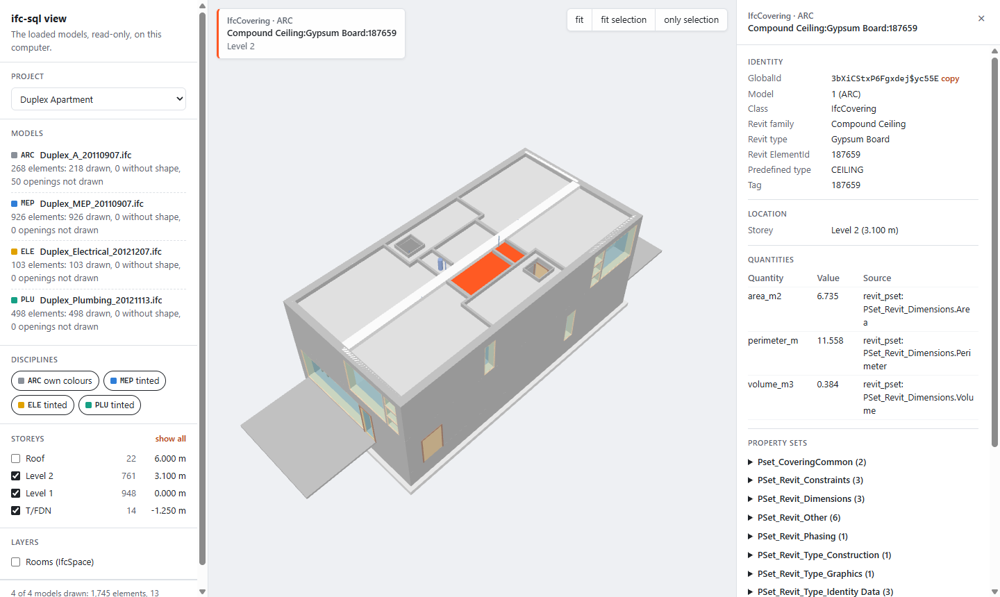

# The viewer: `ifc-sql view`

`ifc-sql view` shows the loaded models in 3D, in your own browser, on your own computer:
every discipline of a project together, storey by storey, with an element's details on a
click. It reads the scenes that `ifc-sql ingest --viewer` built
([ADR 14](adr/0014-viewer.md), decision 1) and nothing else of the files, which the
database does not keep. Beside the models it lists the calls of every MCP server on the
same database that runs with `IFC_SQL_VIEWER_FEED=1`, and lights up what each one found:
[the feed](#the-mcp-servers-calls-the-feed). `ifc-sql demo` plays a script of questions
through the real server, with no LLM, so the page lights up without one:
[the scripted demo](#the-scripted-demo). The design is in ADR 14, decisions 2 to 6; what
the port allows, and who can read and send the feed, is in
[SECURITY.md](../SECURITY.md#the-viewers-port-ifc-sql-view).



*The four Duplex models, after `make ingest-samples`, in `uv run ifc-sql view`: the
storey Roof hidden, a ceiling of the ARC model clicked. Microsoft Edge 158 on Windows 11,
2026-11-23.*

## Start it

The models need their scenes first: `--viewer` at ingest, or on a file already loaded, to
build its scene in place.

```bash
make ingest-samples     # the four Duplex files, with --viewer
make view               # uv run ifc-sql view
```

On Windows, in PowerShell, see [windows.md](windows.md#look-at-the-models-in-3d). The
command prints the page's address on stdout and opens it in your browser:

```
http://127.0.0.1:53358/#t=fIOk_8X-KXsQCZLIly49YiMBCfX-cs87cBYczdvPmG8
```

and on stderr `showing the models at http://127.0.0.1:53358/; stop with Ctrl+C`. Keep it
open while you look; Ctrl+C stops it. The part after `#t=` is a token, new on every
start, that the page needs for every request: a page opened from an earlier start, or
from somewhere else, gets nothing.

| Option | What it does |
|---|---|
| `--project GROUP` | Show this project first: its current models, every discipline together. By default, the project of the newest model that has a scene. The page has a picker for the others. |
| `--model ID` | Show these models instead (repeat it), in that order, each at its origin less the first's. A replaced model may be named, to look at two exports side by side. |
| `--port N` | Listen on this port of 127.0.0.1; 0, the default, takes a free one. A port in use is an error (exit 1). |
| `--no-open` | Print the address, but do not open the browser. |

It needs no other setting than the other commands: `IFC_SQL_DATA_DIR` for the embedded
database, or `IFC_SQL_DATABASE_URL` and `IFC_SQL_READER_PASSWORD`. Like `serve`, it
connects as the read-only role `ifc_reader`, checks first that the database is at the
latest migration, and exits 1 if not; 2 for a `--project` or `--model` that names nothing
loaded. With the embedded database, a database that stopped and started again listens on
another port, so restart `view` then, as `serve` ([ADR 13](adr/0013-embedded-postgresql.md)).

## What the page shows

- **Project.** The current models of one `project_group`, as `list_models` groups them; a
  model of no project is shown on its own. The picker lists every project, the one with
  the newest scene first.
- **Models.** Each with its scene's counts, which add up to the model's elements: "268
  elements: 218 drawn, 0 without shape, 50 openings not drawn" on the Duplex ARC model. A
  model without a scene is greyed out, with the command that builds it, such as `ifc-sql
  ingest revit_quirks.ifc --discipline ELE --viewer`.
- **Disciplines.** A chip per discipline hides or shows its models. ARC keeps its
  materials' colours; MEP is tinted blue, ELE amber and PLU green.
- **Storeys.** One row per storey name across the models ("Level 1" of all four Duplex
  models is one row), highest first, with its elevation and its elements; a row hides or
  shows its chunks. "show all" brings back the hidden ones.
- **Rooms.** The spaces, see-through, loaded when the box is ticked. The spaces that
  repeat a room and Revit's area plans are kept apart in their own chunks, drawn only
  when a call selects one, so that they do not cover the rooms.
- **A click** lights the element in orange, names it over the view, and opens a drawer
  with what `get_element` returns: identity, storey and room, quantities with their
  source, property sets, materials, classifications and data quality findings. A click
  on a stair's flight selects the flight; Escape, or a click on nothing, clears it.
- **fit**, **fit selection** and **only selection** frame what is shown, frame the
  selection, or hide everything else.

- **The feed.** Every call of an MCP server with the feed on, newest first: when it came,
  what it asked (or the demo's question), and how many objects it found. A dot says
  whether calls arrive: live, connecting, interrupted (the page says why) or off. The
  newest call is lit as it arrives; a click on an older one lights it again. A `run_sql`
  call shows its query, as text.
- **A call's caption.** Over the view: who asked (the server's process, or "scripted
  demo, no LLM"), the question, the call in one line (`find_elements: IfcWall on
  'Level 1', model 1`), the counts (`21 found · 21 shown · 0 without shape`, and the
  openings, which are never drawn), what the server says besides (why nothing is lit, or
  that only the first 20,000 are), and a legend of the groups' colours.
- **A call's selection.** Each group in its colour, everything else opaque light grey.
  When every object found lies on one storey, the storeys above it are hidden ("Level 2,
  Roof hidden · show all"). A call that finds only spaces shows nothing else, since the
  rooms are inside the walls. `get_element` moves the camera to its object and opens its
  details. A call that lights nothing by nature (`list_models`, `list_storeys`,
  `describe_schema`) leaves the view as it is.

Every model is placed at its scene's origin less the first model's: the models of a
project line up, as the Duplex's four and the audit's A and D do (ADR 14, P4).

## The scripted demo

No LLM, no MCP client of yours, and no configuration: from a fresh clone,

```bash
make demo              # Linux, after `make up` or with IFC_SQL_DATA_DIR set
```

```powershell
uv sync --locked --extra embedded
$env:IFC_SQL_DATA_DIR = "$env:LOCALAPPDATA\ifc-sql\data"
uv run python scripts/demo.py
```

`scripts/demo.py` downloads the four Duplex files (pinned and checked by SHA-256), runs
`ifc-sql migrate`, loads each file with `--viewer` (a file already loaded gets its scene
in place, or keeps it), checks every model with `ifc-sql dq`, and runs `ifc-sql demo`. It
stops at the first command that fails, with that command's exit code.

`ifc-sql demo` is the client. It starts `ifc-sql serve` over stdio, as Claude Desktop
does, with `IFC_SQL_VIEWER_FEED=1`, serves the page, prints its URL and opens it, and asks
nine questions a few seconds apart. Each call takes the path a real client's takes:
`serve` publishes it, the listener receives it, the feed resolves what it found, and the
page lights it. The page says "scripted demo, no LLM", and numbers the questions. After
the last one the page stays up until Ctrl+C.

| # | Question | Tool call | What it shows | Lights |
|---|---|---|---|---|
| 1 | What is loaded? | `list_models` | 4 models: 268, 926, 103 and 498 elements | nothing; the four disciplines are shown |
| 2 | The architectural walls on Level 1 | `find_elements` ARC, `IfcWall`, `Level 1` | 21 walls | 21 walls; Level 2 and Roof hidden |
| 3 | Which walls are external, by type? | `run_sql`: the README's query, with `array_agg(e.object_id) AS object_ids` per type | 12, 4, 4 and 3 walls of four types | 23 walls in 4 colours |
| 4 | The door schedule | `schedule` ARC, `IfcDoor`, by `revit_type`, `width_m` and `Pset_DoorCommon.FireRating` | 14 doors in 4 types; every fire rating the placeholder `'Fire Rating'` | 14 doors in 4 colours: 6, 4, 2, 2 |
| 5 | The rooms | `space_schedule` ARC | 21 spaces, 422.0 m² | 21 rooms |
| 6 | Rooms counted twice | `space_schedule` MEP | 42 spaces, 21 of them an MEP Space over a room | 21 rooms and their 21 copies, in two colours |
| 7 | What lacks a fire rating? | `data_quality_report` ARC, `rule_id=missing_fire_rating` | 78 walls, doors and slabs | 78 elements |
| 8 | One wall in full | `get_element` ARC, GlobalId `0iEHWY1$XA8eQeeULq4jDb` | everything stored about it: 16,353 characters of compact JSON | the wall; the camera goes to it, its details open |
| 9 | A write is refused | `run_sql` `DELETE FROM ifc.property` | `query refused: only a query that reads data is allowed …` | nothing; the feed shows `refused` |

The models are found by their files' SHA-256, never by id: ids depend on the order the
files were loaded in. Step 8's 16,353 characters are those of a database where the ARC
file was loaded first, as above; the ids in the result have as many digits there as in
the docs' examples. `tests/samples/test_duplex_demo.py` pins every figure and every
selection of the table.

| Option | What it does |
|---|---|
| `--check` | Serve no page: ask every question, compare each call's outcome, figure and selection with the script, print a line per question, and exit 1 when one differs. CI runs it on Linux and on Windows. |
| `--pause SECONDS` | Seconds between two questions (5 by default). |
| `--step` | Wait for Enter before each question. |
| `--port N`, `--no-open` | As for `view`. |
| `--script duplex` | The questions: the Duplex's, the only script yet. |

`uv run python scripts/demo.py --check` on Windows 11, with the PostgreSQL 16 of the
`embedded` extra, on 2026-11-23:

```
1/9 What is loaded? [list_models, ok, 2,496 characters]: 4 models: 268, 926, 103 and 498 elements; lights nothing (feed only): ok
2/9 The architectural walls on Level 1 [find_elements, ok, 8,189 characters]: 21 walls; lights 21 objects: ok
3/9 Which walls are external, by type? [run_sql, ok, 518 characters]: 12, 4, 4 and 3 walls of four types; lights 23 objects in 4 groups (12, 4, 4, 3): ok
4/9 The door schedule [schedule, ok, 1,815 characters]: 14 doors in 4 types, every fire rating the placeholder 'Fire Rating'; lights 14 objects in 4 groups (6, 4, 2, 2): ok
5/9 The rooms [space_schedule, ok, 7,145 characters]: 21 spaces, 422.0 m²; lights 21 objects: ok
6/9 Rooms counted twice [space_schedule, ok, 14,354 characters]: 42 spaces, 21 of them an MEP Space over a room; lights 42 objects in 2 groups (21, 21): ok
7/9 What lacks a fire rating? [data_quality_report, ok, 2,222 characters]: 78 walls, doors and slabs without a fire rating; lights 78 objects: ok
8/9 One wall in full [get_element, ok, 16,353 characters]: everything stored about one wall: its properties, materials and findings; lights 1 object: ok
9/9 A write is refused [run_sql, refused, 149 characters]: refused before it reaches the database; lights nothing: ok
all 9 steps as the script says
```

The characters are those of each result's text: what an LLM would have read.

## The MCP server's calls (the feed)

To see the calls of your own client, run the server it starts with the feed on, and keep
`ifc-sql view` open on the same database:

```bash
IFC_SQL_VIEWER_FEED=1 uv run ifc-sql serve     # as your MCP client starts it
uv run ifc-sql view                            # every view on the database receives them
```

[docs/mcp.md](mcp.md#running-it) lists the setting. With it, `ifc-sql serve` stays
stdio-only, as ever: after every call, once the call's own read-only transaction has
rolled back, it opens one more session, sends one PostgreSQL notification on the channel
`ifc_viewer_feed` in a committed `READ ONLY` transaction that does nothing else, and
closes it (ADR 14, decision 4). A notification that fails is logged and changes nothing
else; the client gets its result either way. With the feed off, nothing is sent and no
session is opened. A call the SDK refuses before any code runs (an argument of the wrong
type, say) never reaches the server's code, and so never reaches the feed.

`ifc-sql view` always listens: one session as `ifc_reader`, `ifc-sql-mcp-viewer-feed` in
`pg_stat_activity`, in a thread of its own. When it loses that session (the database
restarted, someone ended it) the page says "interrupted", and it connects again, waiting
a little longer each time; a call made meanwhile is not shown. The embedded database,
stopped and started again, listens on another port, so restart `view` and the client's
`serve` then ([ADR 13](adr/0013-embedded-postgresql.md)). A `serve` and a `view` on two
databases see nothing of each other: the page names the database it listens on.

### What a call lights

`view` resolves each call when it arrives, with fixed queries of the tools' own SQL and
the call's arguments as bind parameters: the whole filter, not the page the call
returned. At most 20,000 objects; the caption says when there were more. A data quality
run or a load after the call can change what it would light later; what the page shows
is what it found when it came.

| Tool | What is lit |
|---|---|
| `find_elements` | Every match of the filter, on all pages: `tools.find_element_ids` shares the WHERE clause with `find_elements`, so the two never disagree. |
| `schedule` | The same elements, one colour per group of `group_by`, in the schedule's order. |
| `quantity_takeoff` | By `storey`, `ifc_class` or `revit_type`: each group's elements, one colour per group, openings left out unless `include_openings`. By `material`: nothing, and the caption says why: an element of three materials counts three times. |
| `get_element` | The one object; the camera goes to it and its details open. |
| `space_schedule` | Every space of the model: rooms, the copies of rooms (`duplicate_of`) and Revit Areas, in three colours; their chunks are shown. |
| `data_quality_report` | With `rule_id`: every object with a finding of that rule in the model's latest run. Without it: every object with a finding, coloured by its worst severity (red, amber, blue). The report's `severity` and `scope` apply. A model never checked says so. |
| `compare_models` | The newer model's objects added since the older one, and those whose properties changed, in two colours. Removed objects are only in the older model: the caption counts them. |
| `run_sql` | The ids its rows hold: an `object_id` column (one group), an `object_ids` array column (one group per row, labelled by the row's first column), or `global_id` or `global_ids` beside a `model_id` column (GlobalIds are unique per model only). With the feed on, the tool's description tells the LLM so. |
| `list_models`, `list_storeys`, `describe_schema` | Nothing: they are listed, and the view stays as it is. |

A call that failed lights nothing, and the caption says how it ended.

### The event

One notification per call, JSON, at most 7,999 bytes of UTF-8: PostgreSQL refuses a
payload of 8,000 or more (ADR 14, P7). Version 1:

| Field | Holds |
|---|---|
| `v` | 1. |
| `src` | The `serve` process: `{pid, started_at}`. |
| `n`, `at` | The call's number in that process, and when it ended (UTC). |
| `tool`, `arguments` | The call, as the tool received it; for `run_sql` without its text. A text longer than 200 bytes is clipped, and named in `clipped`: such a call lights nothing. |
| `outcome`, `seconds`, `rows` | As `serve`'s log line has them: `ok`, `invalid`, `refused`, `timeout`, `database_error`, `unavailable` or `error`. |
| `sql` | For `run_sql`: `{text, chars, sha256_16}`, the text clipped to what fits, its length, and the fingerprint of the log line. |
| `ids` | For `run_sql` and `get_element`, whose result holds the selection itself: `{groups: [{label, object_ids, global_ids}], truncated}`, at most 500 ids and 4,800 bytes. |

The ids come first, the SQL text gets what is left. Measured by
`tests/unit/viewer/test_event.py`: 500 object ids of seven digits take 4,076 bytes of the
event, and with 20,000 non-ASCII characters of SQL beside them the event is 7,999 bytes,
the text clipped to its first 1,821 characters. The event never carries text from an
IFC file: the summary the page shows ("find_elements: IfcWall on 'Level 1', model 1") is
made from the arguments.

Any login to the database can send a notification on the channel, so `view` trusts none:
it drops an unknown version, a field of the wrong type, a tool that does not exist, an id
that is not a positive integer, a GlobalId that is not one, more than 500 ids, arguments
that a real call of the tool could not have (checked with the tool's own argument model,
as the MCP SDK checks them), and more than 10 events a second after a burst of 30. It
numbers what it keeps itself, keeps the last 200 calls (the selections of the last 50),
counts what it dropped by reason, and logs a reason once, never the payload. It never
runs SQL that came from an event: `run_sql`'s text is shown, as text.

## Measured

`window.ifcViewer.measure(10)`, in the browser's console, orbits the camera for ten
seconds, drawing every frame, and returns what it drew: frames per second, the worst
frame, draw calls, triangles, the batches' vertices and the JS heap. `window.ifcViewer`
also says when the page is `ready`, and after how many milliseconds (`ready_ms`).

On a desktop: Windows 11, Intel Core i7-14700F, NVIDIA GeForce RTX 4060 Ti, 32 GB,
Microsoft Edge 158 (ANGLE on Direct3D 11), a 144 Hz display, the canvas 1,284 × 901 CSS
pixels at a device scale of 1; three.js r187; 2026-11-23. The tab's memory is the private
bytes of its renderer process, and the GPU process's as Windows reports them.

| Scene | Chunks | Primitives (instances) | Vertices | Triangles | Draw calls | Ready after | Frames per second | Worst frame | JS heap | Tab | GPU process |
|---|---:|---:|---:|---:|---:|---:|---:|---:|---:|---:|---:|
| File B, the tower (`R8_F1_MAB_AR_M3_XX_XXX_MO_7000.ifc`) | 28 | 12,774 | 831,231 | 1,598,866 | 76 | 0.93 s | 144.1 | 15 ms | 68 MB | 173 MB | 219 MB |
| The four Duplex models | 13 | 1,822 | 411,473 | 753,614 | 23 | — | 144.2 | 7 ms | 31 MB | — | — |

- 144 frames per second is the display's refresh rate: the cap. Phase 0 measured the same
  76 draw calls and the same cap on file B with a prototype and three.js r185.1 (ADR 14,
  P6); the page's JS heap is half the prototype's 141 MB, because it frees each chunk's
  parsed meshes once they are in the batches.
- The batches hold 831,231 vertices, as many as file B's scene: each primitive has its
  own (P6). The prototype's shared buffers had made it 1,040,891.
- "Ready after" is from the start of the page's load to the last of the 28 chunks drawn,
  25.2 MB read from the embedded database on the same machine.
- **Not measured yet: a laptop.** No laptop was at hand for this phase, so the plan's
  laptop figure is still to be added: open file B on one and add a row with
  `ifcViewer.measure(10)`.

## How it is built

`ifc-sql view` binds 127.0.0.1 itself (so a taken port is an error it reports), and runs
the app of `viewer/http.py` with uvicorn: no lifespan, no access log, uvicorn logging
through the project's stderr logger, two seconds to finish on Ctrl+C.

| Route | Returns |
|---|---|
| `GET /` | The page, `index.html`. No token. |
| `GET /static/{path}` | The page's own files, and no others: no listing, no `..`. No token. |
| `GET /api/models` | `list_models` with every model's scene (or the command that builds one), the projects, and the set shown first. |
| `GET /api/models/{id}/scene` | The manifest: the origin, the counts, and each chunk's number, kind, storey, elements, bytes and SHA-256. |
| `GET /api/models/{id}/scene/{chunk_no}.glb` | The chunk, `model/gltf-binary`, with its SHA-256 as `ETag`: a reload revalidates it and gets a 304. |
| `GET /api/models/{id}/objects/{global_id}` | `get_element`, clipped as the MCP server clips it. |
| `GET /api/feed` | The feed: the listener's status and the calls kept, each with what it lit. |
| `GET /api/events` | The same as server-sent events: `status` when it changes, `call` per call. A stream begins with every call kept, or, when the browser comes back with `Last-Event-ID`, with those after it. `EventSource` cannot send a header, so this route alone also takes the token as `?t=`. |

Every `/api/` route reads as `ifc_reader` in a read-only transaction with the MCP server's
limits (5 s per statement); the routes and the feed's selections together hold at most
three sessions at once, and the listener one more (`ifc_reader` allows 20, shared with
every MCP call on the cluster). No route runs SQL that came from a request or an event.
`tests/samples/test_duplex_demo.py` samples `pg_stat_activity` while the Duplex demo
plays, and checks that it stays within those numbers, with `serve` at one session at a
time: a call's own session is closed before its notification's opens.

The page is plain ES modules, with no build step and no npm, in
`src/ifc_sql_mcp/viewer/static/`:

| File | Does |
|---|---|
| `index.html`, `viewer.css` | The layout. The import map is the only inline script. |
| `main.js` | The sidebar, the loading of the chunks (four at a time), the toggles, the selection, a call's caption. |
| `feed.js` | The list of calls from the event stream, the feed's state, a call's selection handed to the view. |
| `scene.js` | Each chunk into two BatchedMeshes, one opaque and one transparent, one instance per primitive; the map from GlobalId to instances; picking, lighting groups in their colours with the rest grey, fitting, `measure`. |
| `details.js` | The drawer. |
| `api.js` | The one seam for data: the token, `fetch` with `Authorization: Bearer`, and the `EventSource` of the feed. |
| `dom.js` | The one way the page makes elements: text as `textContent`, never HTML. |
| `vendor/three/` | three.js r187, unminified, with its MIT licence and `SHA256SUMS`. |

## Upgrading three.js

three.js is vendored and committed, so the page needs no network and no build. To move to
a newer release:

1. **Pick the release**: the newest at least two weeks old (`npm view three time`, or
   <https://registry.npmjs.org/three>). r187 was picked on 2026-11-22 (ADR 14, P5).
2. **Download it into an empty folder, and check it** against npm's integrity field:

   ```bash
   mkdir /tmp/three && cd /tmp/three
   curl -sSfLO https://registry.npmjs.org/three/-/three-0.187.0.tgz
   curl -sSf https://registry.npmjs.org/three/0.187.0 | grep -o '"integrity":"[^"]*"'
   echo "sha512-$(openssl dgst -sha512 -binary three-0.187.0.tgz | openssl base64 -A)"
   tar -xzf three-0.187.0.tgz
   ```

   The two `sha512-…` values must be equal.
3. **Copy the files** into `src/ifc_sql_mcp/viewer/static/vendor/three/`, as they are:
   `package/build/three.module.js` and `three.core.js`; `package/LICENSE`;
   `package/examples/jsm/loaders/GLTFLoader.js` into `addons/loaders/`,
   `utils/BufferGeometryUtils.js` and `utils/SkeletonUtils.js` into `addons/utils/`, and
   `controls/OrbitControls.js` into `addons/controls/`. If `GLTFLoader.js` imports
   another addon (`grep "from '" GLTFLoader.js`), copy that too: a test fails on an import
   that is not vendored. Do not name a folder `build/`: `.gitignore` ignores it.
4. **Write `SHA256SUMS`** again, in that folder (`--text` makes Git Bash on Windows write
   two spaces, as on Linux):

   ```bash
   sha256sum --text LICENSE three.core.js three.module.js addons/*/*.js > SHA256SUMS
   ```

5. **Update the release** in `tests/unit/viewer/test_page.py` (`REVISION = '187'`), on
   this page, in ADR 14 and in the README's licences.
6. **Check**: `uv run pytest tests/unit/viewer`; then open the Duplex and file B with
   `ifc-sql view`, click an element, and record the frames per second above.

`.gitattributes` keeps git from changing the vendored files' line endings on Windows, and
`.pre-commit-config.yaml` keeps the whitespace fixers and the 500 KB limit off them:
r187 publishes no minified build, and `three.core.js` alone is 1.5 MB.
